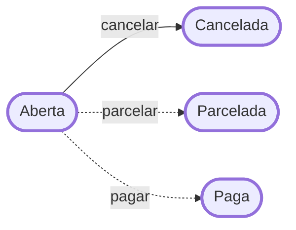

# Ciclo de vida da fatura

Documento negocial da funcionalidade · Status: rascunho

## Objetivo

Mostrar as situações da fatura e o que muda cada uma.

## Atores e telas

_Nada registrado._

## Fluxo principal



*Figura 1: Ciclo de vida da fatura*

| Estado | Descrição |
| --- | --- |
| Aberta (início) | Situação inicial de toda fatura.[^1] |

| Transição | Evento | Descrição | Confiança |
| --- | --- | --- | --- |
| Aberta → Cancelada | cancelar | Sem pagamento e com motivo de ao menos 10 caracteres.[^2] | confirmado |
| Aberta → Parcelada | parcelar | Só fatura aberta pode ser parcelada.[^3] | inferido |
| Aberta → Paga | pagar |  | a confirmar |

- **[confirmado]** Carência de 3 dias sem encargos (RN-FAT-003): Atraso de até DIAS_CARENCIA dias corridos (hoje 3) não gera multa nem juros. A partir do quarto dia, multa e juros são cobrados.[^4][^5][^6]

## Fluxos alternativos

_Nada registrado._

## Exceções

_Nada registrado._

## Regras de negócio

_Nada registrado._

## Dados lidos e gravados

_Nada registrado._

## Integrações

_Nada registrado._

## Perguntas em aberto

_Nenhuma pergunta em aberto._

## Sugestões de alteração

_Nenhuma sugestão registrada._

## Evidências

[^1]: `db/01_tabelas.sql:28`
[^2]: `db/03_pkg_cobranca.sql:111-128`
[^3]: `backend/src/main/java/exemplo/faturamento/ParcelamentoService.java:27`
[^4]: `db/03_pkg_cobranca.sql:66-69`
[^5]: `db/03_pkg_cobranca.sql:90-92`
[^6]: `db/02_parametros.sql:12-13`

## Apêndice: trechos citados

### [1] `db/01_tabelas.sql:28`

```sql
28 |     STATUS            VARCHAR2(10)   DEFAULT 'ABERTA' NOT NULL,
```

### [2] `db/03_pkg_cobranca.sql:111-128`

```sql
111 |         IF V_STATUS <> 'ABERTA' THEN
112 |             RAISE_APPLICATION_ERROR(-20010, 'Somente fatura ABERTA pode ser cancelada');
113 |         END IF;
114 |
115 |         IF V_VL_PAGO > 0 THEN
116 |             RAISE_APPLICATION_ERROR(-20011, 'Fatura com pagamento parcial nao pode ser cancelada');
117 |         END IF;
118 |
119 |         IF P_MOTIVO IS NULL OR LENGTH(TRIM(P_MOTIVO)) < 10 THEN
120 |             RAISE_APPLICATION_ERROR(-20012, 'Motivo do cancelamento deve ter ao menos 10 caracteres');
121 |         END IF;
122 |
123 |         UPDATE FATURA
124 |            SET STATUS          = 'CANCELADA',
125 |                MOTIVO_CANCEL   = TRIM(P_MOTIVO),
126 |                DT_CANCELAMENTO = SYSDATE,
127 |                USUARIO_CANCEL  = P_USUARIO
128 |          WHERE ID_FATURA = P_ID_FATURA;
```

### [3] `backend/src/main/java/exemplo/faturamento/ParcelamentoService.java:27`

```java
27 |             throw new RegraNegocioException("Somente fatura ABERTA pode ser parcelada");
```

### [4] `db/03_pkg_cobranca.sql:66-69`

```sql
66 |         -- Dentro da carencia nao ha multa
67 |         IF V_DIAS <= FN_PARAMETRO('DIAS_CARENCIA') THEN
68 |             RETURN 0;
69 |         END IF;
```

### [5] `db/03_pkg_cobranca.sql:90-92`

```sql
90 |         IF V_DIAS <= FN_PARAMETRO('DIAS_CARENCIA') THEN
91 |             RETURN 0;
92 |         END IF;
```

### [6] `db/02_parametros.sql:12-13`

```sql
12 | INSERT INTO PARAMETRO (CHAVE, VALOR, DESCRICAO)
13 | VALUES ('DIAS_CARENCIA', 3.0000, 'Dias corridos apos o vencimento sem cobranca de encargos');
```
