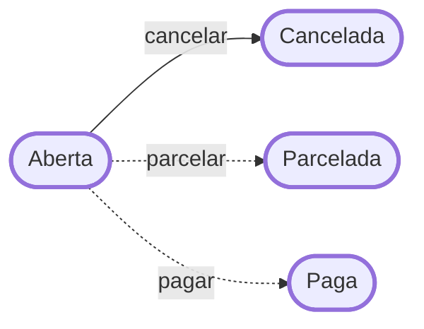

# Ciclo de vida da fatura

Documento negocial da funcionalidade · Status: rascunho

## Objetivo

Mostrar as situações da fatura e o que muda cada uma.

## Atores e telas

_Nada registrado._

## Fluxo principal

*Figura 1: Ciclo de vida da fatura*

| Estado | Descrição |
| --- | --- |
| Aberta (início) | Situação inicial de toda fatura.[^1] |

| Transição | Evento | Descrição | Confiança |
| --- | --- | --- | --- |
| Aberta → Cancelada | cancelar | Sem pagamento e com motivo de ao menos 10 caracteres.[^2] | confirmado |
| Aberta → Parcelada | parcelar | Só fatura aberta pode ser parcelada.[^3] | inferido |
| Aberta → Paga | pagar |  | a confirmar |

- **[confirmado]** Carência de 3 dias sem encargos (RN-FAT-003): Atraso de até DIAS_CARENCIA dias corridos (hoje 3) não gera multa nem juros. A partir do quarto dia, multa e juros são cobrados.[^4][^5][^6]

## Fluxos alternativos

_Nada registrado._

## Exceções

_Nada registrado._

## Regras de negócio

_Nada registrado._

## Dados lidos e gravados

_Nada registrado._

## Integrações

_Nada registrado._

## Perguntas em aberto

_Nenhuma pergunta em aberto._

## Sugestões de alteração

_Nenhuma sugestão registrada._

## Evidências

[^1]: `db/01_tabelas.sql:28`
[^2]: `db/03_pkg_cobranca.sql:111-128`
[^3]: `backend/src/main/java/exemplo/faturamento/ParcelamentoService.java:27`
[^4]: `db/03_pkg_cobranca.sql:66-69`
[^5]: `db/03_pkg_cobranca.sql:90-92`
[^6]: `db/02_parametros.sql:12-13`
