# Revisão de UX: dashboard do projeto, condução do analista e acesso às issues

- **Data:** 2026-11-23
- **Issue:** #312 (só análise e proposta; nenhum código do app foi alterado)
- **Versão avaliada:** 0.6.0, `develop` em `d3c15df`, modo dev no macOS, com o projeto de referência OpenCBS (`docs/projeto-de-referencia.md`)
- **Protótipos:** [`prototipos/index.html`](prototipos/index.html) (HTML estático, claro e escuro) e o canvas editável em https://claude.ai/artifact/YKYzNKyi53vVFU1m42VRGA (privado; o dono precisa compartilhar para outros abrirem)

## 1. Resumo

O app tem as peças certas, mas elas estão organizadas por tipo de tela, não pelo que o analista quer fazer. Os três achados que mais pesam:

1. **O projeto está partido em cinco lugares.** As análises ficam no Início e no explorador, as regras e as demandas em "Projeto", o cadastro e a saúde em "Configurações", as funcionalidades em "Mapa" e as issues do rastreador dentro do Mapa. Nenhuma tela responde "como o projeto está".
2. **A condução existe, mas mostra um passo só e apenas no Início.** Na base de teste havia cinco análises aguardando revisão e o ambiente do Claude por preparar; o Início sugeria revisar a A-0007 e não dizia nada do ambiente.
3. **Não dá para escolher uma issue para analisar.** As issues só aparecem em Mapa › "Vincular demandas", e esse botão some quando o mapa está vazio. No formulário de impacto, o campo "Issue do projeto" é texto livre: o analista precisa saber o número de cor.

A proposta põe o projeto no centro: um seletor de projeto na barra de título e um menu lateral com rótulos (Visão geral, Atividades, Análises, Demandas, Base, Funcionalidades, Código). "Visão geral" é o dashboard, "Atividades" é a caixa de entrada do analista e "Demandas" junta as issues do rastreador e as demandas da base, com "Analisar impacto" em cada linha.

As áreas Funcionalidades e Base de conhecimento têm um diagnóstico e uma proposta próprios na seção 9.

O plano (seção 10) tem 16 issues candidatas. As quatro primeiras entregam o dashboard e a condução com os dados que o backend já tem ou calcula com pouco esforço.

## 2. Como a revisão foi feita, e os limites

- O app rodou em modo dev com `CBA_DATA_DIR` descartável, sobre uma cópia da base do teste de uso da #205: 1 projeto, 9 análises (2 aprovadas, 5 aguardando revisão, 2 em andamento), 24 regras, 1 termo, 1 demanda. O rastreador foi apontado para `OpenCBS/OpenCBS-Cloud`, que tem issues.
- Percorri as telas pela janela do app (captura de tela e cliques), no tema claro e, em duas telas, no escuro. Os prints estão em [`prints/`](prints/).
- Nos prints, a barra de status foi cortada e os caminhos de pasta da máquina de teste foram cobertos (prints 10, 13-2 e 15); o resto da tela está como o app mostra.
- A avaliação usa as dez heurísticas de Nielsen e a escala de gravidade de 0 a 4 (0 não é problema, 1 cosmético, 2 menor, 3 maior, 4 impede a tarefa).

**O que não foi executado nesta sessão:**

- **Análise nova com o agente ao vivo.** O preparo do ambiente do Claude altera a configuração do Claude Code, e a sessão não tinha permissão para isso. As jornadas "fazer uma pergunta" e "analisar impacto" foram percorridas até o envio do formulário; a tela com o agente trabalhando vem da evidência da #205 (versão 0.4.0, print 15) e do código atual.
- **Mapeamento de funcionalidades com o agente.** O mapa da base de teste estava vazio, e mapear exige o agente. Para ver as telas de Funcionalidades com conteúdo (lista, painel da funcionalidade e "Vincular demandas"), gravei à mão um `mapa.estado.json` ilustrativo com 7 funcionalidades na base descartável. As telas são as reais; os nomes e os vínculos das funcionalidades são inventados.
- **Cadastro completo de um projeto novo.** O assistente foi percorrido até o passo do código; o clone e a prévia do inventário já tinham sido avaliados na #205 (C-01 a C-14) e não mudaram de desenho.

Observação sobre a issue: ela cita a "seção 3" da spec para as personas. O público está na seção 2 (`docs/specs/2026-11-11-mvp-standalone.md`); a seção 3 é o escopo.

## 3. Personas e jornadas

### 3.1 Personas

| | Analista de requisitos (primária) | Analista de negócio ou PO | Desenvolvedor que confere (secundária) |
|---|---|---|---|
| Na spec | recebe demandas de mudança em legado e descreve o que muda | quer entender como o sistema trata um caso de negócio | valida uma análise e confere as evidências |
| Lê código | pouco ou nada | não | sim |
| Frequência | diária | algumas vezes por semana | quando chamado |
| Ao abrir o app quer | saber o que espera por ele e qual demanda atacar | fazer uma pergunta e achar a resposta de ontem | ir direto à análise e ao trecho de código |
| Vocabulário | demanda, regra, história, critério | regra, caso, exceção | arquivo, linha, commit |
| Não conhece | MCP, hooks, sessão, pontos de entrada | idem | o vocabulário negocial da base |

### 3.2 O que o analista quer ao abrir o app

**Uso diário.** Na ordem em que as perguntas aparecem:

1. Alguma coisa parou esperando por mim? (agente com pergunta, análise concluída)
2. Chegou demanda nova? Qual eu analiso agora?
3. Onde estava aquela análise de ontem?
4. Como está o projeto no geral: quanto já foi analisado, o que falta?

Hoje, a pergunta 1 tem resposta parcial no Início (um passo). A 2 não tem resposta no app. A 3 se resolve pelo explorador, se o analista lembrar o número. A 4 não tem tela.

**Primeiro uso.** O analista quer chegar à primeira resposta útil sem entender a arquitetura. O assistente leva até o cadastro, mas o passo do ambiente fala em "servidor MCP" e "hooks", e o app depois do assistente abre com telas vazias que não dizem o que fazer.

### 3.3 Jornadas avaliadas

| Jornada | Caminho hoje | Prints | Problemas |
|---|---|---|---|
| Primeiro uso | assistente de 5 passos | 13-1 a 13-5 | P-14, P-15 |
| Cadastrar um projeto | Início › "+ Novo projeto" ou Configurações › "+ Novo projeto" (mesmo assistente do passo 3) | 13-3, 07 | P-01, P-20 |
| Fazer uma pergunta | Início › "Perguntar ao sistema" ou área Análises | 01, 05, 15 | P-02, P-05, P-15 |
| Analisar o impacto de uma demanda | Início › "Analisar impacto" › digitar a issue ou escolher a demanda | 12, 11 | P-03, P-04, P-18 |
| Revisar e aprovar | Início › próximo passo, ou explorador › análise › "Aprovar…" | 08, 09 | P-05, P-11, P-12 |
| Retomar uma análise | explorador › análise › "Escolher onde continuar" | 10 | P-07, P-13, P-19 |
| Consultar a base | área Base (busca) ou área Projeto (regras e glossário) | 04, 02, 03, 19, 20 | P-09, P-10, P-16, B-01 a B-09 |

## 4. Diagnóstico

### 4.1 O que funciona e deve ser mantido

- **"Próximo passo" do Início** (`ui/src/proximoPassoInicio.ts`): a ordem de prioridade está certa (responder ao agente, revisar, revalidar, preparar, retomar, primeira análise). A proposta amplia esse mecanismo, não o troca.
- **Painel da demanda** (print 11): linha do tempo, matriz de rastreabilidade, pendências e pauta num lugar só. É o melhor exemplo de "objeto como centro" do app e o modelo para a visão geral do projeto.
- **Saúde do projeto em Configurações** (print 07): quatro itens com situação e ação direta. Vira a faixa de selos do cabeçalho do dashboard.
- **Tela da análise**: filtros por decisão, atalhos de teclado e sumário por seção.
- Textos em português e tema claro e escuro consistentes.

### 4.2 Telas

**Início** (print 01). O passo sugerido e as listas estão bem resolvidos, mas a tela mistura todos os projetos e não tem números.

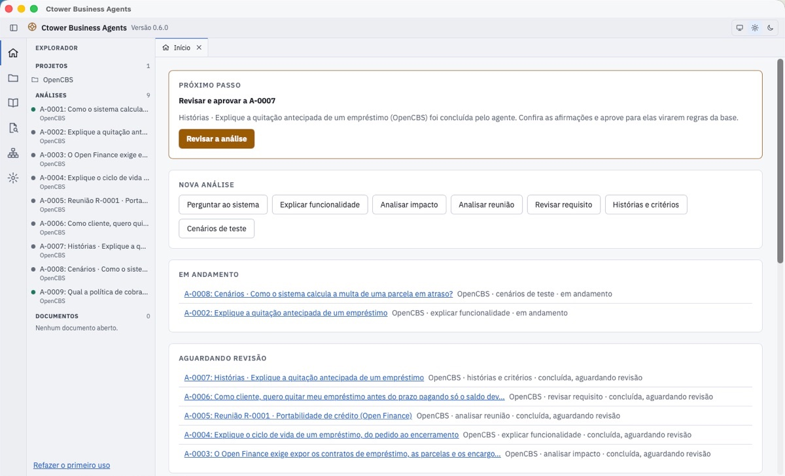

**Projeto** (prints 02 e 03). É uma página longa: demandas, áreas, 24 regras, glossário, cobertura e mapa, nessa ordem e sem sumário. A cobertura e o mapa ficam no fim, depois de toda a lista de regras.

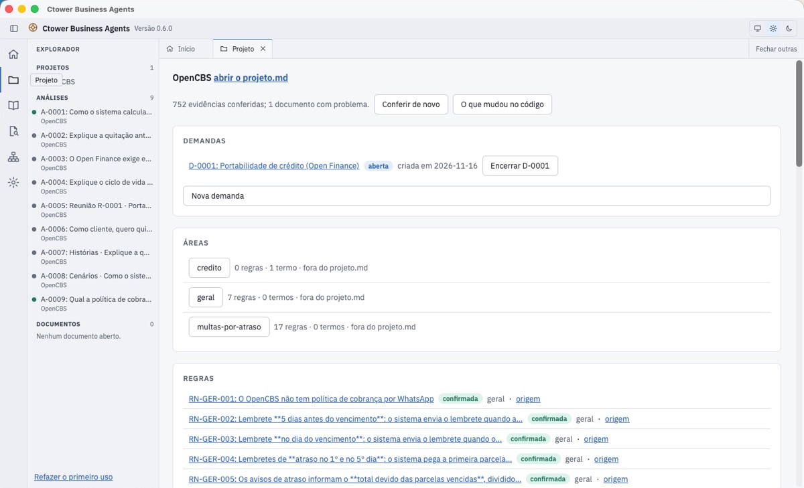

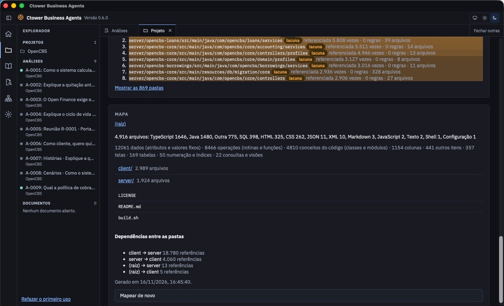

**Análises** (print 05). O ícone "Análises" abre o formulário "Pergunta ao sistema"; a lista de análises fica abaixo dele. O aviso do ambiente aparece aqui, e não no Início.

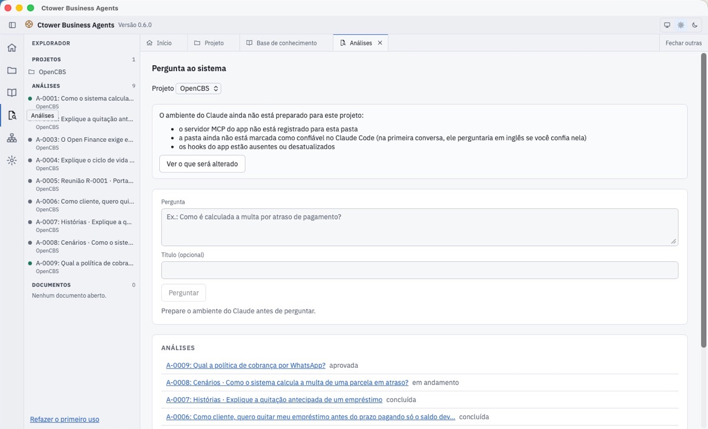

**Base de conhecimento** (print 04). Lista plana de 43 documentos de todos os tipos.

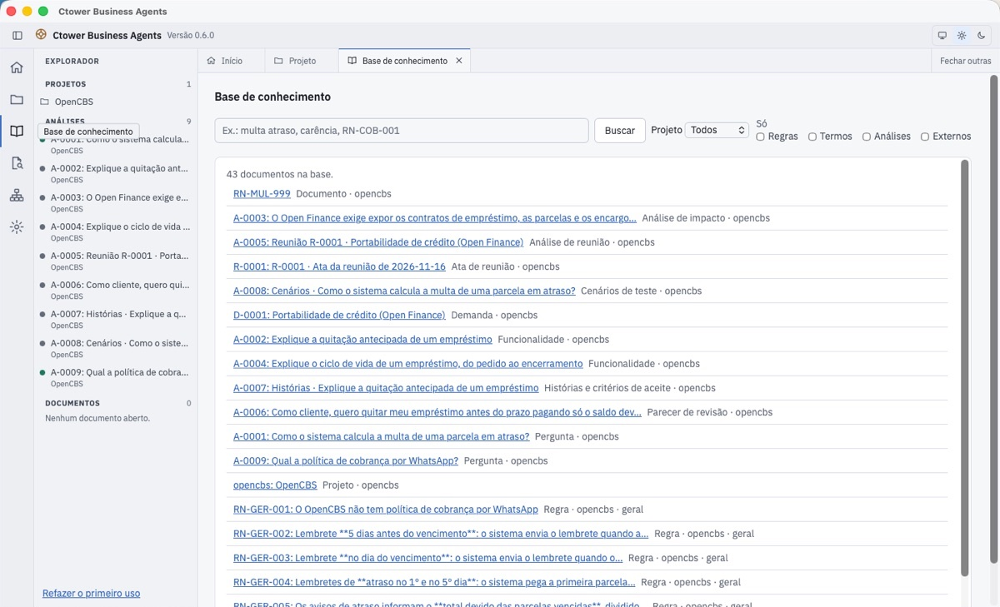

**Mapa de funcionalidades** (print 06). Com o mapa vazio, a tela despeja 2.250 pontos de entrada com caminho de arquivo. O botão "Vincular demandas", única porta para as issues do rastreador, não aparece.

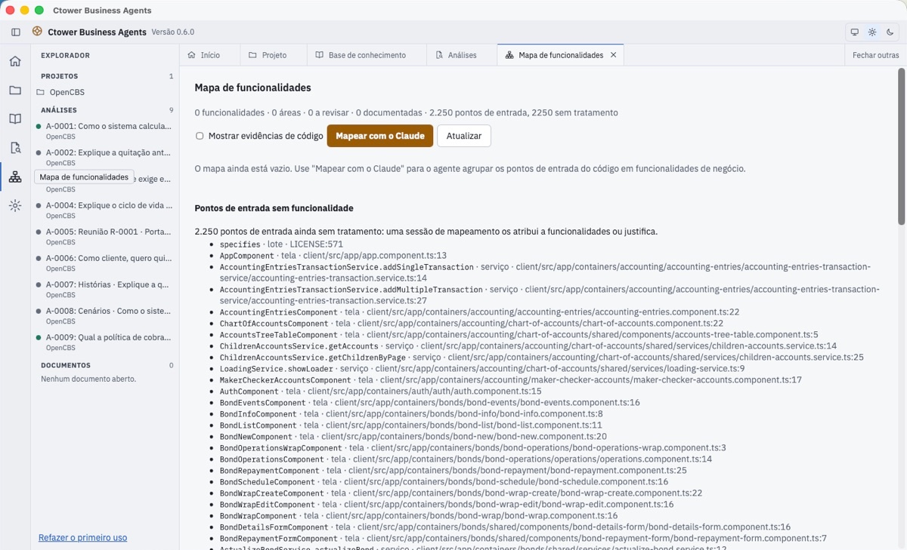

**Configurações › projeto** (print 07). A aba "Visão geral" é a saúde da configuração, não a visão geral do projeto.

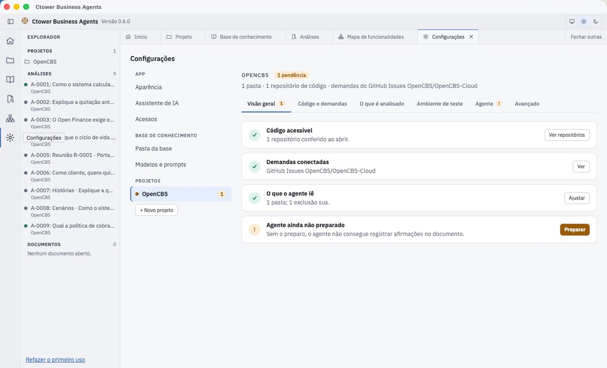

**Análise em revisão** (prints 08 a 10). Sem conversa aberta, o documento ocupa cerca de um terço da largura e o painel vazio, dois terços. Os selos do cabeçalho são cortados.

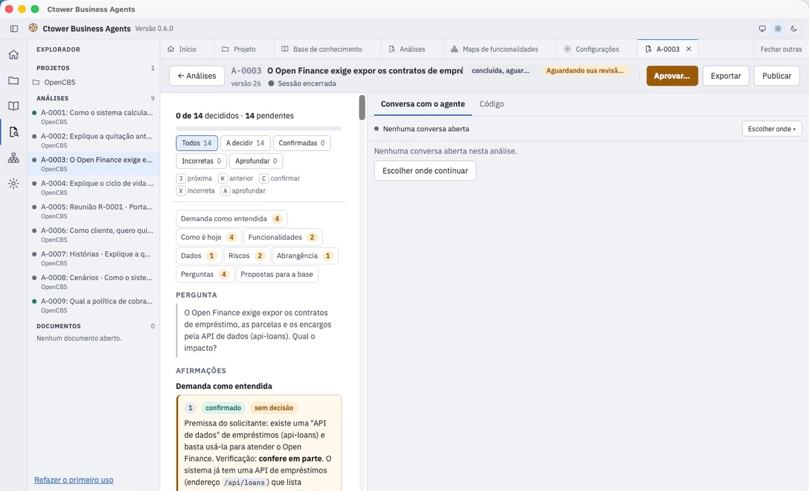

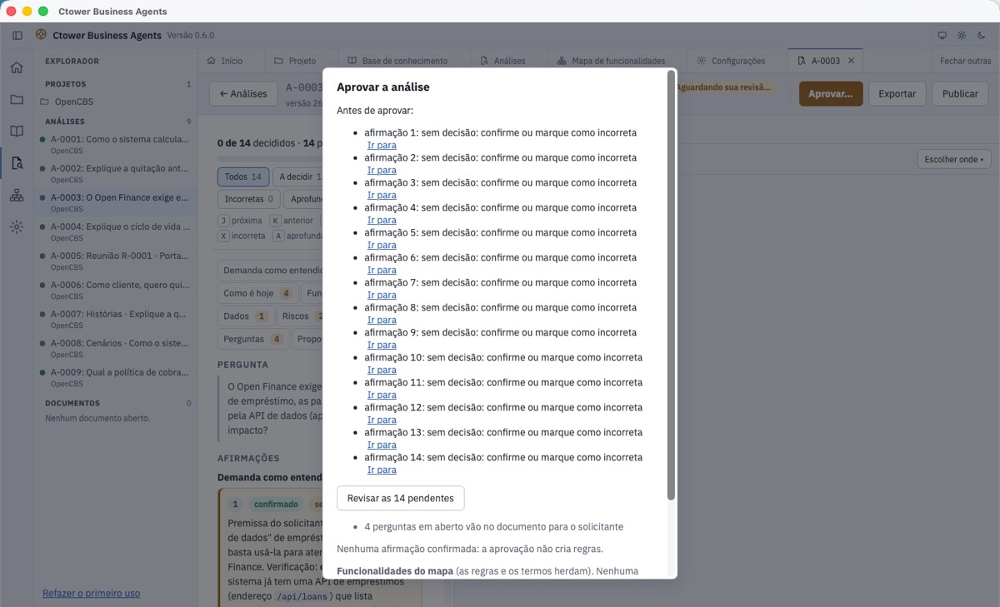

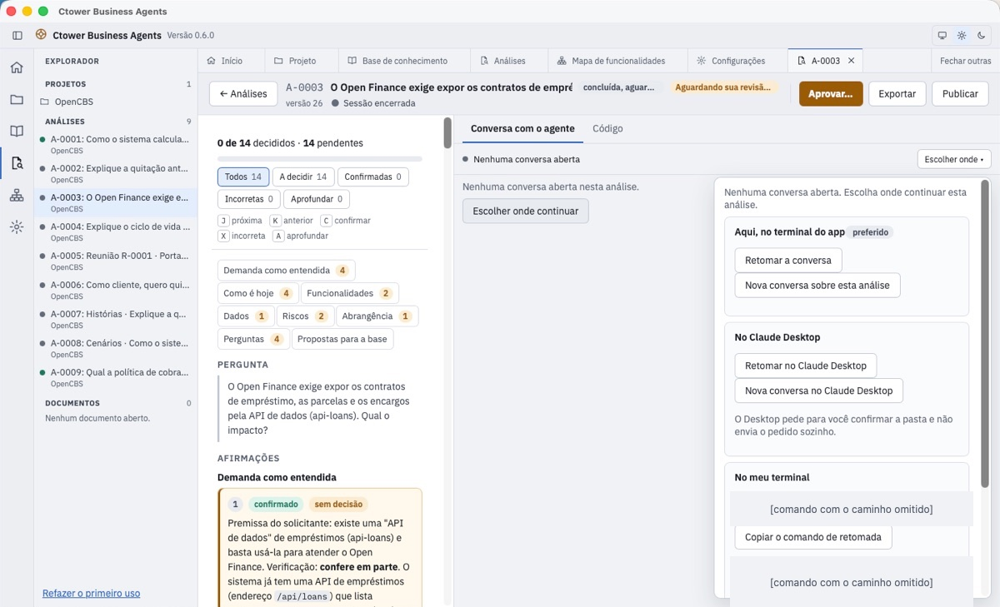

**Demanda** (print 11) e **formulário de impacto** (print 12).

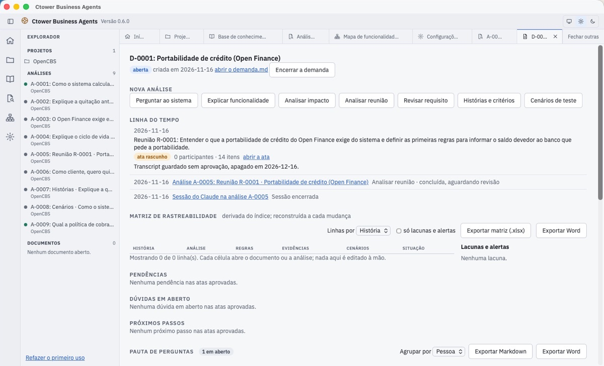

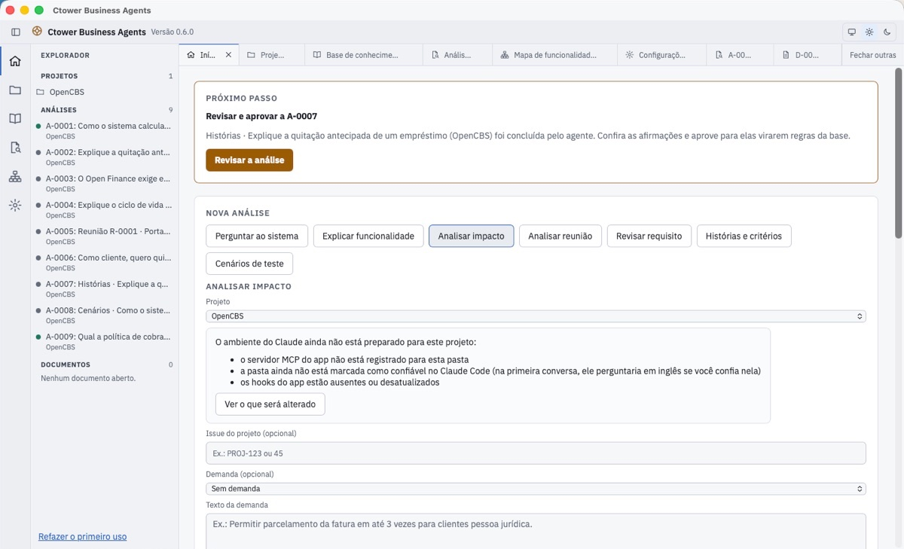

**Primeiro uso** (prints 13-1 a 13-5).

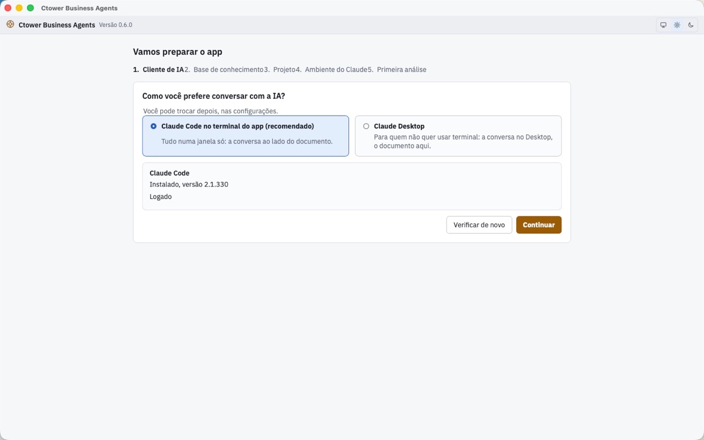

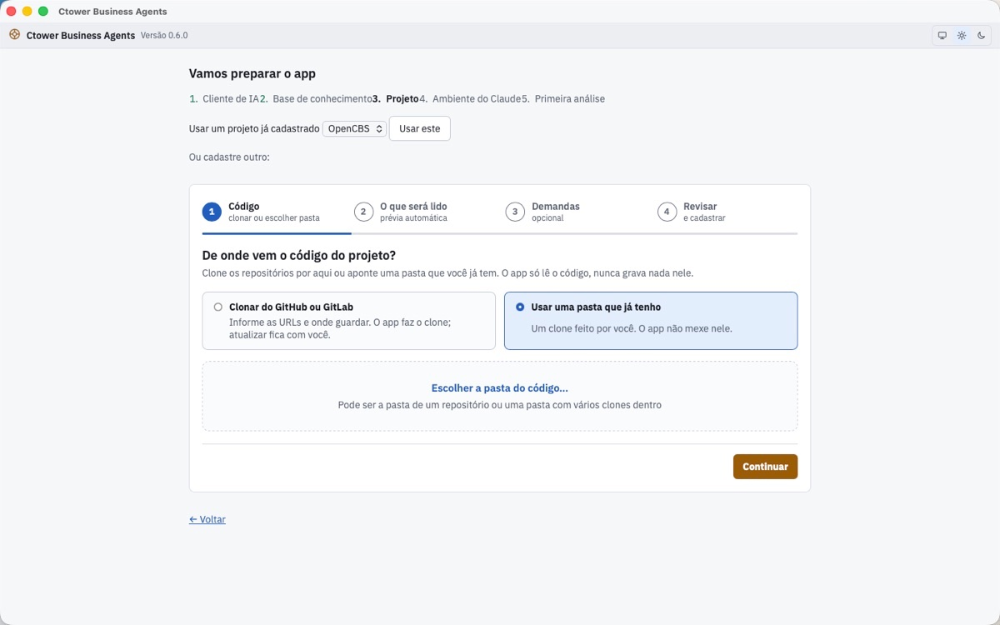

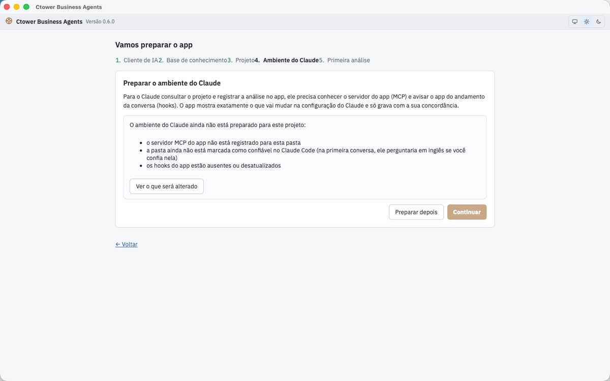

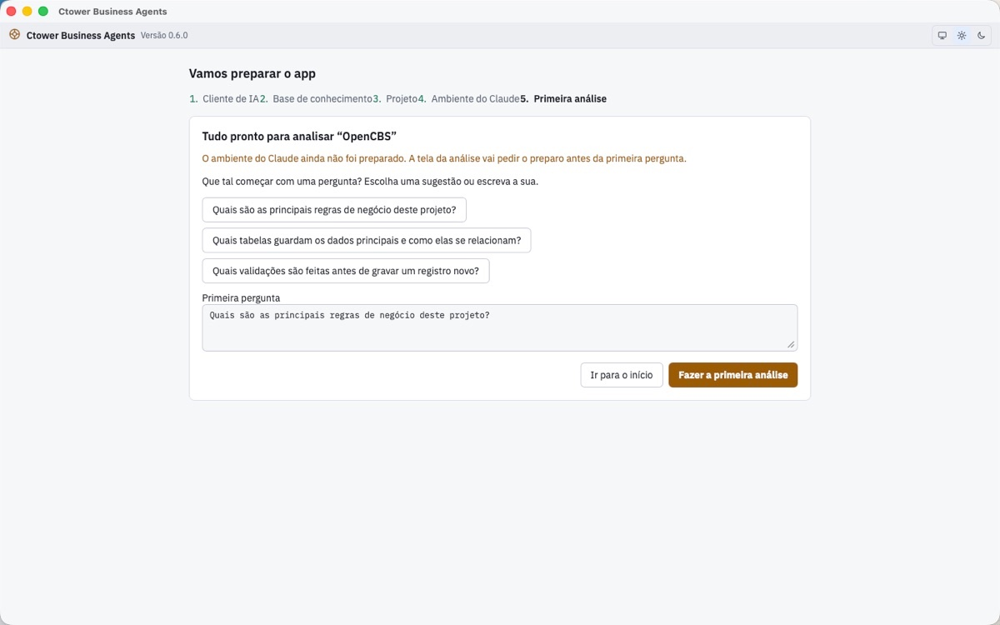

**Sessão ao vivo** (print 15, da #205, versão 0.4.0).

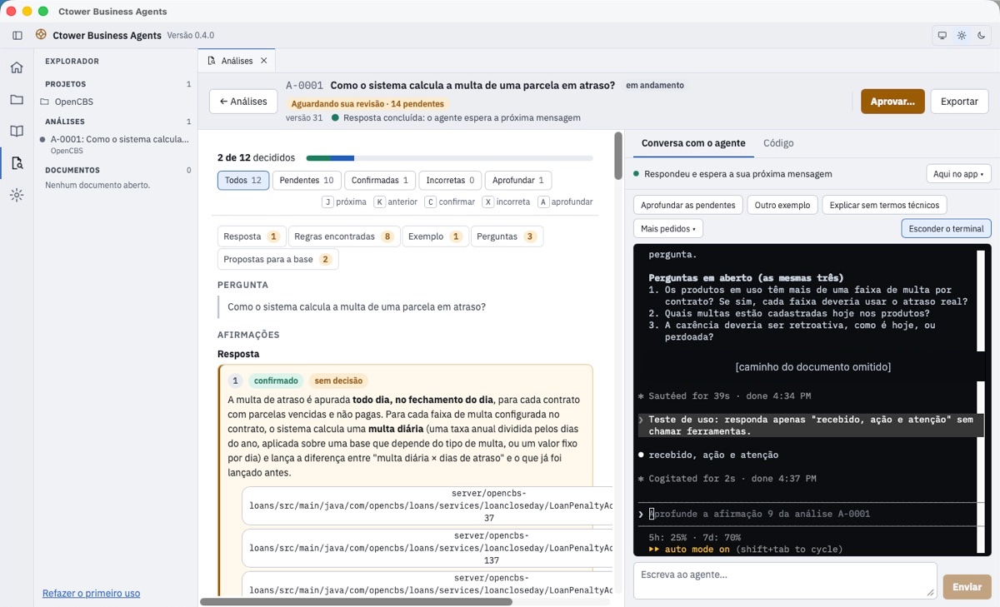

### 4.3 Problemas, por gravidade

Heurísticas: H1 visibilidade do estado, H2 correspondência com o mundo real, H3 controle e liberdade, H4 consistência, H5 prevenção de erro, H6 reconhecer em vez de lembrar, H7 flexibilidade e eficiência, H8 minimalismo, H9 recuperação de erros, H10 ajuda.

| ID | Problema | Onde | Heurística | Grav. |
|---|---|---|---|---|
| P-01 | O projeto está partido em cinco áreas e nenhuma mostra o estado dele de relance | navegação | H1, H6 | 3 |
| P-03 | As issues do rastreador só aparecem em Mapa › "Vincular demandas", botão que some com o mapa vazio; no formulário de impacto a issue é texto livre | prints 06, 12 | H6, H7 | 3 |
| P-04 | O estado da demanda é só local e não confere com o rastreador (#292); qualquer contagem de "abertas" sai errada | Projeto, painel da funcionalidade | H1 | 3 |
| P-05 | A condução mostra um passo só, apenas no Início, e esconde os outros: cinco revisões pendentes e o ambiente por preparar não aparecem juntos | print 01 | H1 | 3 |
| P-09 | A tela Projeto é uma rolagem única sem sumário; cobertura e mapa ficam depois de todas as regras, e a cobertura é uma lista de caminhos de pasta | prints 02, 03 | H8, H2 | 3 |
| P-11 | Na análise: selos cortados ("concluída, aguar…"), documento em um terço da largura com o painel de conversa vazio, e "confirmado" (confiança do agente) ao lado de "Confirmadas" (decisão do analista) | print 08 | H2, H4 | 3 |
| P-15 | Ambiente por preparar: o aviso técnico se repete em cada formulário, o botão é "Ver o que será alterado" e o envio fica desabilitado com uma frase no rodapé | prints 05, 12 | H2, H9 | 3 |
| P-02 | O ícone "Análises" abre "Pergunta ao sistema"; a lista fica abaixo do formulário | print 05 | H4 | 2 |
| P-06 | A barra de atividades só tem ícones; o rótulo aparece ao passar o mouse, e "Projeto" e "Mapa" não se distinguem pelo desenho | todas | H6 | 2 |
| P-07 | O explorador lista todas as análises de todos os projetos, com título cortado e um ponto colorido sem legenda | todas | H6, H1 | 2 |
| P-08 | Cada área vira uma aba; um passeio pelo app abre oito, e os títulos encolhem para "Iní…" e "A-00…" | print 11 | H8 | 2 |
| P-10 | Títulos de regra com markdown cru (`**…**`) nas listas (já relatado na #205, E-05) | prints 02, 04 | H4 | 2 |
| P-12 | O diálogo "Aprovar" repete 14 linhas iguais ("afirmação N: sem decisão") em vez de um resumo com uma ação | print 09 | H8 | 2 |
| P-13 | "Escolher onde continuar" aparece duas vezes e expõe comandos de terminal a quem não usa terminal | print 10 | H2, H8 | 2 |
| P-14 | Primeiro uso: passos colados ("Cliente de IA2."), jargão ("MCP", "hooks"), "Continuar" desabilitado sem motivo e "Tudo pronto" junto de "o ambiente ainda não foi preparado" | prints 13-1, 13-4, 13-5 | H2, H4, H1 | 2 |
| P-16 | A Base é uma lista plana com regra, análise, ata e demanda misturadas, sem agrupar por tipo | print 04 | H8, H6 | 2 |
| P-17 | Mapa vazio: 2.250 linhas de caminho de arquivo antes de qualquer orientação | print 06 | H8, H2 | 2 |
| P-18 | O painel da demanda só se alcança por Projeto › Demandas; não há área de demandas | print 02 | H6 | 2 |
| P-19 | Não há lista de sessões do agente; "N sessões aguardam você" na barra de status é texto, não leva à sessão | barra de status | H1, H7 | 2 |
| P-20 | "Visão geral" em Configurações é a saúde do cadastro; o nome ocupa o lugar da visão geral que falta | print 07 | H4 | 1 |

Informação duplicada: a lista de análises aparece no Início (três listas), no explorador e na área Análises, cada uma com ordem e rótulos de estado diferentes ("concluída, aguardando revisão", "concluída", ponto cinza). A lista de projetos aparece no Início, no explorador e em Configurações.

Informação escondida: issues do rastreador (P-03), cobertura (P-09), sessões (P-19), estado do ambiente (P-05).

Passos que dependem de conhecer o app: saber que a demanda fica em "Projeto"; que o preparo fica em Configurações › projeto › Agente; que "Vincular demandas" existe e só aparece com o mapa preenchido; que o número da issue vai digitado; que fechar a aba da análise encerra a conversa.

## 5. Arquitetura de informação

### 5.1 Atual

```
Barra de atividades (só ícones)      Explorador (global)
├─ Início          todos os projetos ├─ Projetos
├─ Projeto         demandas, áreas, regras, glossário, cobertura, mapa estrutural
├─ Base            busca em todos os documentos
├─ Análises        formulário "Pergunta" + lista
├─ Mapa            funcionalidades ── Vincular demandas (issues do rastreador)
└─ Configurações   app · base · projetos (saúde, código e demandas, agente)
                                     ├─ Análises (todas)
                                     └─ Documentos abertos
Sem área própria: Demanda (abre por Projeto) e Vincular (abre pelo Mapa)
```

### 5.2 Proposta: o projeto como centro

```
Barra de título: [Projeto ▾]  [Buscar… ⌘K]
Menu lateral (ícone + rótulo + contagem)
PROJETO
├─ Visão geral      dashboard: saúde, próximos passos, indicadores
├─ Atividades (n)   caixa de entrada: responder, revisar, demandas novas, revalidar, preparar
├─ Análises         lista com filtro por situação e tipo; "Nova análise" é ação global
└─ Demandas         issues do rastreador + demandas da base; painel da demanda
CONHECIMENTO
├─ Base             regras · glossário · documentos (abas), busca
├─ Funcionalidades  mapa de funcionalidades + cobertura
└─ Código           mapa estrutural + o que mudou
─
Configurações       app (aparência, IA, acessos, pasta da base, modelos)
"Configurar projeto" abre do cabeçalho da Visão geral
```

### 5.3 Comparação

| Aspecto | Hoje | Proposta |
|---|---|---|
| Unidade de navegação | tipo de tela | projeto escolhido |
| Ao abrir o app | Início com todos os projetos | Visão geral do último projeto; com vários projetos, o seletor mostra as pendências de cada um |
| Rótulos | só no hover | sempre à vista, com contagem |
| Estado do projeto | espalhado | Visão geral |
| O que fazer agora | um passo, no Início | Atividades, com selo no menu, e os três primeiros na Visão geral |
| Issues do rastreador | dentro do Mapa | Demandas |
| Demandas | seção da tela Projeto | área própria |
| Regras e glossário | tela Projeto | Base |
| Cobertura | fim da tela Projeto | Funcionalidades, e um resumo na Visão geral |
| Saúde e cadastro | Configurações › projeto | selos na Visão geral; o cadastro continua em "Configurar projeto" |
| Lista de análises | três lugares | Análises; o painel lateral deixa de repetir |
| Abas | uma por área e por objeto | só para objetos (análise, documento, demanda); as seções trocam no lugar |

Custos da mudança: a navegação por abas (`Navegacao.tsx`) precisa separar "seção" de "objeto aberto"; quem já usa o app perde a posição dos ícones. O tipo `Tela` e `navegar` continuam servindo, o que permite migrar uma seção por vez.

## 6. Dashboard do projeto

Protótipo: [`prototipos/1-visao-geral.html`](prototipos/1-visao-geral.html).

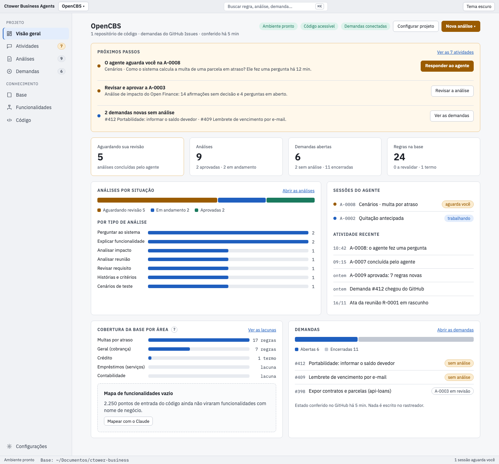

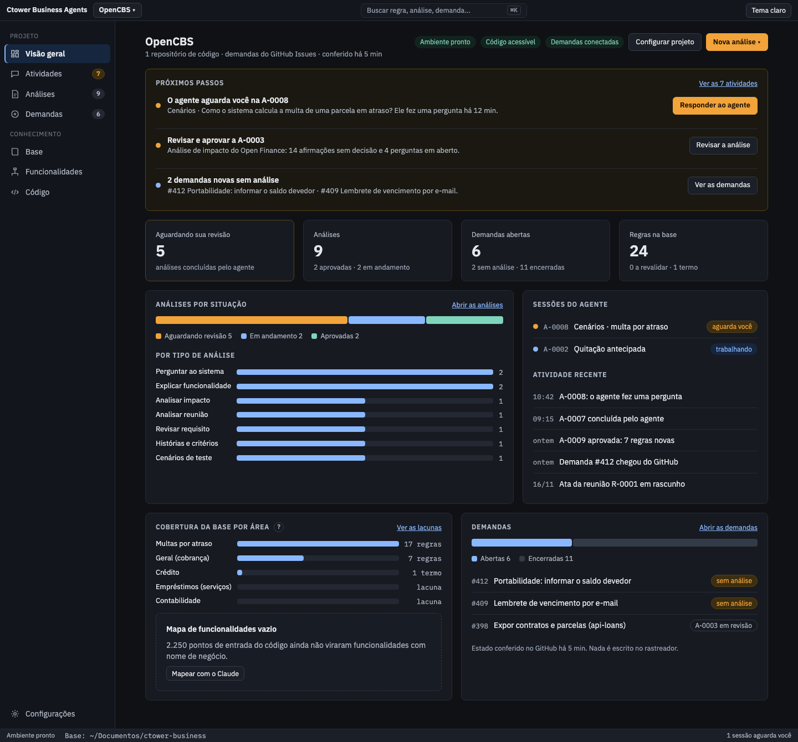

### 6.1 Blocos

1. **Cabeçalho:** nome, origem do código e das demandas, quando foi conferido; selos de saúde (ambiente, código, demandas); "Configurar projeto" e "Nova análise".
2. **Próximos passos:** as três atividades mais urgentes, com a ação de cada uma, e o link para todas.
3. **Quatro números:** aguardando sua revisão, análises, demandas abertas, regras na base. Cada um leva à lista filtrada.
4. **Análises:** barra por situação e barras por tipo.
5. **Sessões do agente e atividade recente.**
6. **Cobertura da base por área**, com as lacunas, e o estado do mapa de funcionalidades.
7. **Demandas:** abertas e encerradas, e as mais recentes com a situação da análise.

Regra de desenho: cor só para estado (âmbar pede ação do analista, azul é o agente trabalhando ou item aberto, verde é concluído), sempre com o rótulo e o número em texto.

### 6.2 De onde vem cada dado

| Indicador | Fonte hoje | O que falta |
|---|---|---|
| Selos de saúde | `verificar_ambiente_projeto` e `prontidao_repositorios_app`, combinados em `ui/src/saudeProjeto.ts` (`itensDeSaude`) | nada; reaproveitar |
| Próximos passos | `inicio_app` + `proximoPasso` (`ui/src/proximoPassoInicio.ts`), que devolve um passo para todos os projetos | devolver a lista inteira, por projeto (seção 7) |
| Análises por situação | `listar_analises_projeto` devolve `AnaliseResumo {id, titulo, fluxo, estado, atualizada_ms}`; a UI pode contar | nada para a contagem; um agregado no backend evita ler os nove `estado.json` a cada abertura |
| Análises por tipo | o mesmo `AnaliseResumo.fluxo` | idem |
| Aguardando revisão | `estado == concluida` em `listar_analises_projeto` ou `inicio_app` | nada |
| Afirmações sem decisão por análise ("0 de 14") | só dentro da análise (`ui/src/resumoRevisao.ts`, no cliente) | contagem por análise no resumo do backend |
| Perguntas em aberto | `EstadoPergunta` em cada `A-NNNN.estado.json`; a pauta existe por demanda | contagem por projeto |
| Demandas abertas e encerradas | `listar_demandas_app` devolve `DemandaVista {status, criado, encerrado}`; a UI conta | o status é só local: depende da #292 para valer |
| Demandas sem análise | `painel_demanda_app` tem a linha do tempo por demanda | um campo "análises ligadas" na listagem, para não abrir painel por painel |
| Issues novas do rastreador | `issues_para_vincular_app` (lê `gh` ou `jira` a cada chamada) | comando próprio, com cache e data da última leitura (seção 8) |
| Regras, a revalidar, termos | `inicio_app` (`ProjetoInicio {regras, a_revalidar, termos}`) e `visao_projeto` | nada |
| Cobertura por área | `cobertura_projeto_app` (`Cobertura {areas, pastas, sugestao, totais}`) | nada; a tela precisa mostrar o nome da área em vez do caminho da pasta |
| Funcionalidades | `mapa_funcionalidades_projeto` (`MapaVista {total, pendentes, documentadas, completude}`) | nada |
| Sessões do agente | `AnaliseInicio.sessao` (a mais recente de cada análise); os registros estão em `<dados>/sessoes/*.json` (`RegistroSessao`) | comando que liste as sessões do projeto com estado; os terminais embutidos vivos só existem em memória |
| Atividade recente | `atualizada_ms` das análises, datas das demandas, linha do tempo da demanda | um histórico: o jornal `<dados>/eventos/<projeto>.jsonl` é truncado e não serve; a primeira versão pode ordenar o que já tem data |

Recomendação: um comando `resumo_projeto_app(projeto)` que devolva de uma vez as contagens (análises por estado e por fluxo, pendências de revisão, perguntas em aberto, demandas, sessões) e a lista de atividades. A Visão geral faz uma chamada, e o mesmo resultado alimenta o selo do menu.

## 7. Condução do analista

Protótipos: [`prototipos/2-atividades.html`](prototipos/2-atividades.html) e [`prototipos/4-projeto-novo.html`](prototipos/4-projeto-novo.html).

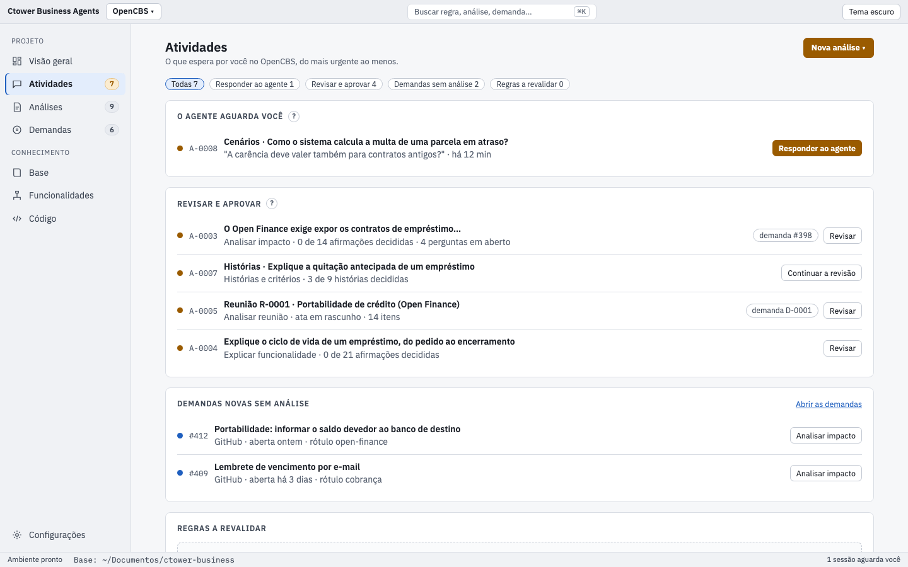

### 7.1 Atividades (uso diário)

A caixa de entrada lista tudo o que espera pelo analista, agrupado por tipo e na ordem de prioridade que o `proximoPasso` já usa:

| Grupo | Quando aparece | Ação | Fonte |
|---|---|---|---|
| O agente aguarda você | sessão em `aguardando-analista` | Responder ao agente | `AnaliseInicio.sessao` |
| Revisar e aprovar | análise em `concluida` | Revisar, com o progresso ("3 de 9 decididas") | `listar_analises_projeto` + contagem nova |
| Demandas novas sem análise | issue aberta sem análise ligada | Analisar impacto | listagem nova (seção 8) |
| Regras a revalidar | `a_revalidar > 0` | Ver as regras | `inicio_app` |
| Ambiente a preparar | `AmbienteClaude.pronto == false` | Preparar | `verificar_ambiente_projeto` |
| Análises paradas | `criada` ou `em-andamento` sem sessão ativa | Retomar | `inicio_app` |

O selo do menu soma os grupos que pedem ação. Os três primeiros itens aparecem na Visão geral. A barra de status passa a levar à atividade ("1 sessão aguarda você" vira botão).

Grupo vazio não some: mostra uma frase que ensina o que apareceria ali ("Quando o código citado por uma regra mudar, ela aparece aqui").

### 7.2 Primeiro uso e projeto novo

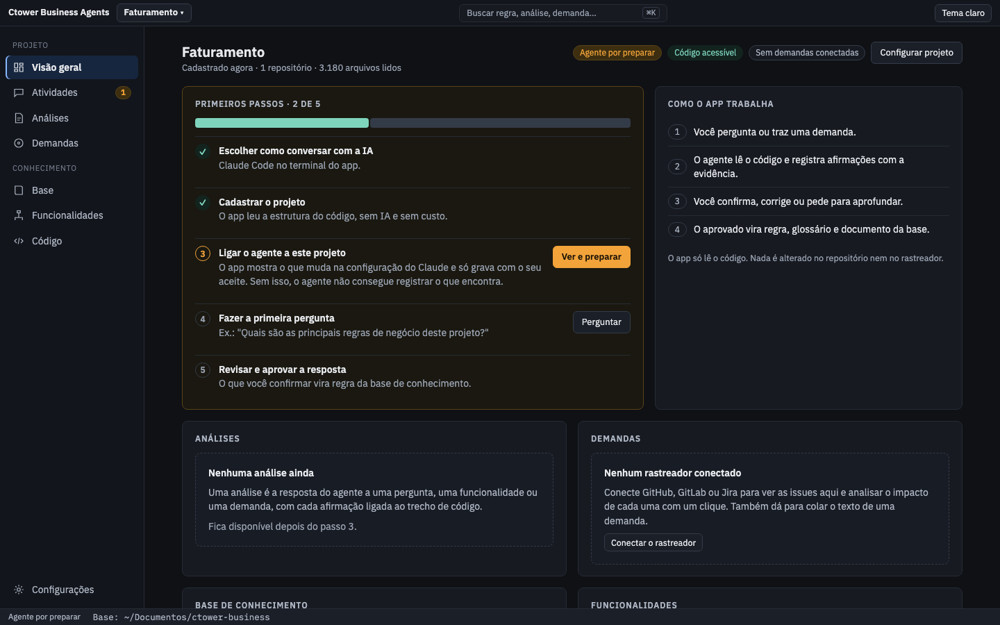

- **Primeiros passos na Visão geral.** O projeto recém-cadastrado abre com uma lista de cinco passos (IA escolhida, projeto cadastrado, ligar o agente, primeira pergunta, revisar e aprovar) e o progresso. Ela substitui o "Tudo pronto" do assistente quando o ambiente ficou para depois (P-14) e some quando a primeira análise é aprovada.
- **Estados vazios que ensinam.** Cada bloco vazio diz o que é o objeto, de onde ele vem e qual ação o cria, e avisa quando depende de um passo anterior.
- **"Como o app trabalha"** em quatro linhas, ao lado dos primeiros passos.
- **Assistente:** corrigir o indicador de passos, dizer por que "Continuar" está desabilitado e trocar "Ver o que será alterado" por "Ver e preparar".

### 7.3 Ajuda no contexto

- **Linguagem.** "Preparar o ambiente do Claude (MCP e hooks)" vira "Ligar o agente a este projeto"; os nomes técnicos ficam em "Detalhes". "Pontos de entrada" ganha a explicação "telas, serviços e rotinas por onde o sistema é usado". A confiança do agente passa a "com evidência" e "inferido", para não colidir com a decisão "confirmada".
- **"?" ao lado dos títulos** que usam termo do app (cobertura, a revalidar, aguardando revisão), com uma frase.
- **Motivo junto do botão desabilitado**, com o atalho para resolver ("Ligue o agente para perguntar").
- **Legenda dos estados** no próprio rótulo: o ponto colorido do explorador vira selo com texto.

## 8. Issues do projeto

Protótipo: [`prototipos/3-demandas.html`](prototipos/3-demandas.html).

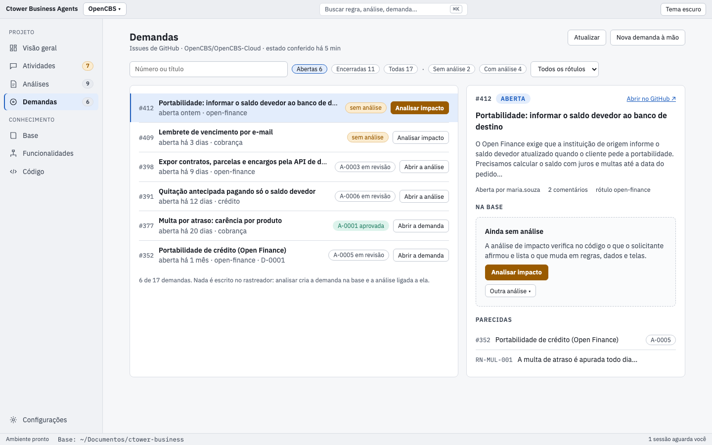

### 8.1 Hoje

- `listar_issues` (`crates/cba-repos/src/listagem.rs`) lê GitHub e Jira por período de criação (seis meses por padrão), com teto de 200. **GitLab devolve erro de "ainda não suportado".**
- O único comando da UI é `issues_para_vincular_app`, pensado para vincular issues a funcionalidades. Não tem busca, filtro de estado nem cache: cada abertura chama `gh` ou `jira`.
- A busca e o filtro de estado existem na tela `VincularIssues`, no cliente, sobre o que já foi lido.
- A demanda da base nasce `aberta` e não acompanha o rastreador (#292).
- `criar_analise_de_demanda` já cria uma análise de impacto a partir de uma referência de issue, sem criar a demanda.

### 8.2 Proposta

Uma lista só, "Demandas", com as issues do rastreador e as demandas criadas à mão.

- **Linha:** número, título, idade, rótulos, situação na base (sem análise, análise em revisão, análise aprovada) e uma ação. A ação muda com a situação: "Analisar impacto", "Abrir a análise" ou "Abrir a demanda".
- **Busca** por número ou título e **filtros** por estado (abertas, encerradas, todas), por situação na base e por rótulo. O padrão é "abertas".
- **Painel lateral** da issue selecionada: descrição, link para o rastreador, o que já existe na base e itens parecidos (demandas e regras), para o analista não analisar duas vezes a mesma coisa.
- **Frescor:** "estado conferido há 5 min" e "Atualizar". Sem rede, a lista mostra a última leitura e avisa.
- **Nada é escrito no rastreador.**

### 8.3 Fluxo até "Analisar impacto"

1. O analista abre Demandas (ou clica "2 demandas novas sem análise" na Visão geral ou em Atividades).
2. A lista vem do cache e se atualiza em segundo plano.
3. Ele clica "Analisar impacto" na linha da issue.
4. O app cria a demanda na base com a chave e a origem (ou reaproveita a que existe), cria a análise de impacto com o texto da issue como entrada e abre a análise com o agente.
5. A linha passa a mostrar "A-NNNN em andamento"; concluída a análise, ela aparece em Atividades para revisão.

Dois cliques, sem digitar número. O formulário de impacto continua existindo para a demanda colada como texto, e o campo "Issue do projeto" vira uma busca sobre a mesma lista.

### 8.4 Relação com as demandas da base e com a #292

| | Issue do rastreador | Demanda da base |
|---|---|---|
| Onde vive | GitHub, GitLab ou Jira | `demandas/D-NNNN-…/demanda.md` |
| Quando existe | sempre que o rastreador tem | quando o analista analisa, vincula ou cria à mão |
| Estado | o do rastreador | hoje local; com a #292, o conferido no rastreador, mais o status local do analista |

A lista mostra a issue mesmo sem demanda na base; a demanda nasce no primeiro uso. A #292 é pré-requisito do número "demandas abertas" do dashboard e do filtro de estado. O cache da listagem proposta aqui pode ser o mesmo que a #292 precisa para conferir o estado.

## 9. Funcionalidades e Base de conhecimento

As duas áreas guardam o conhecimento do projeto. Na proposta de navegação elas formam o grupo "Conhecimento" do menu. Esta seção detalha o diagnóstico e a proposta de cada uma.

Protótipos: [`prototipos/5-funcionalidades.html`](prototipos/5-funcionalidades.html) e [`prototipos/6-base.html`](prototipos/6-base.html).

### 9.1 Funcionalidades: como está

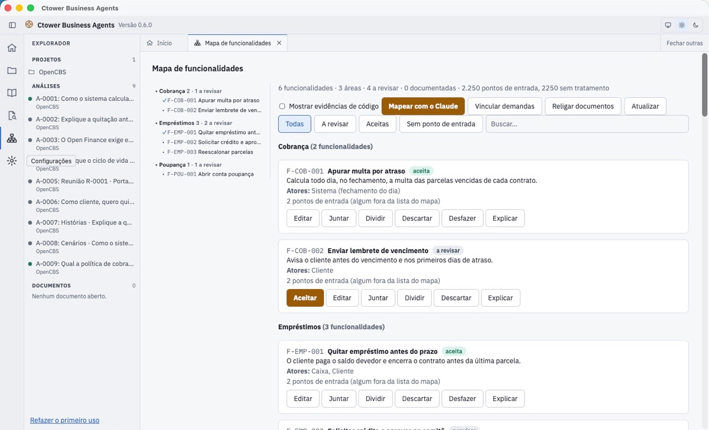

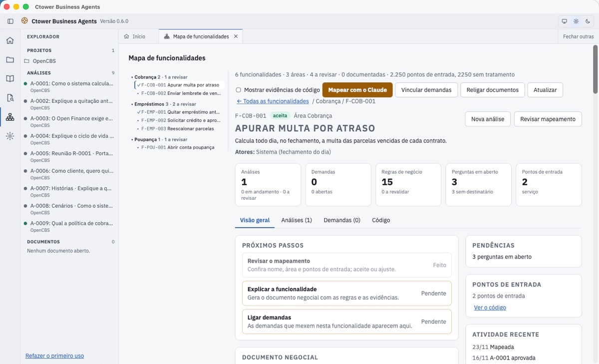

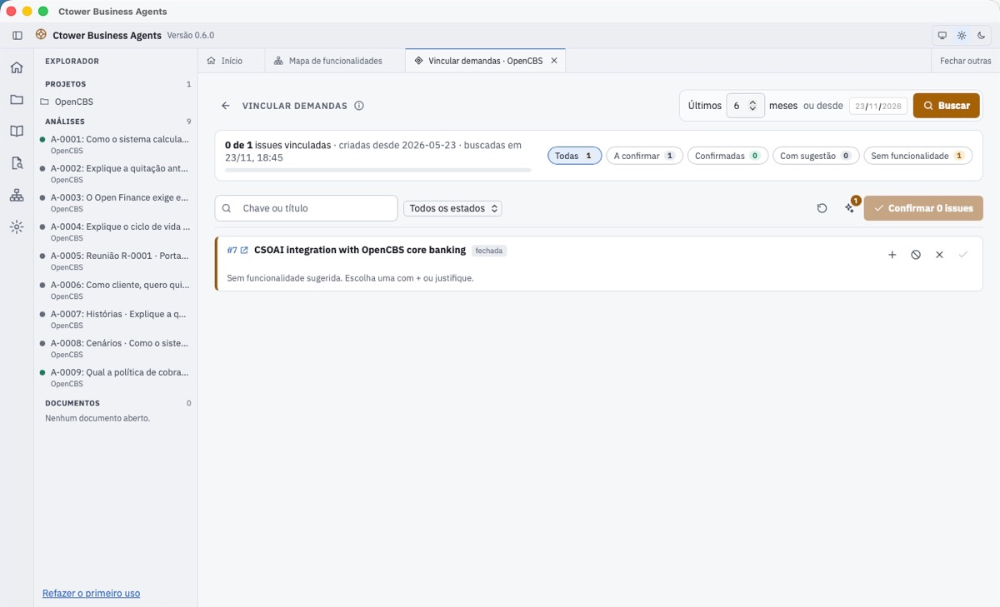

O que funciona:

- **O painel da funcionalidade** (print 17) já é um dashboard pequeno: cinco números (análises, demandas, regras, perguntas em aberto, pontos de entrada), próximos passos, abas e atividade recente. É o desenho que a Visão geral do projeto repete um nível acima.
- A árvore por área, com a marca de aceita e a contagem "a revisar".
- O filtro por situação e a busca.

Problemas:

| ID | Problema | Onde | Heurística | Grav. |
|---|---|---|---|---|
| F-06 | "Vincular demandas" abre vazia e pede um período antes de mostrar qualquer issue; as ações de cada issue são quatro ícones sem rótulo (+, proibido, ×, ✓); não dá para abrir nem analisar a issue dali | print 18 | H6, H2 | 3 |
| F-07 | A cobertura, que diz onde o mapa e a base têm lacunas, fica no fim da tela Projeto e fala de pastas do código, não de funcionalidades | print 03 | H2, H6 | 3 |
| F-01 | O resumo é uma linha de contagens ("6 funcionalidades · 3 áreas · 4 a revisar · 0 documentadas · 2.250 pontos de entrada, 2250 sem tratamento"): não mostra quanto do sistema já foi mapeado, e o mesmo número aparece com e sem separador de milhar | print 16 | H1, H4 | 2 |
| F-02 | Cada cartão repete seis ou sete botões do mesmo peso (Aceitar, Editar, Juntar, Dividir, Descartar, Desfazer, Explicar); a lista de seis funcionalidades já ocupa três telas | print 16 | H8 | 2 |
| F-03 | Jargão: "pontos de entrada", "sem tratamento", "(algum fora da lista do mapa)", "Religar documentos" | prints 16, 06 | H2 | 2 |
| F-04 | O painel da funcionalidade só abre pela árvore lateral, em letra pequena; o cartão não tem "abrir" e não mostra o que o painel sabe (análises, regras, demandas) | prints 16, 17 | H6, H7 | 2 |
| F-05 | A barra junta ações de pesos diferentes: mapear, vincular demandas, religar documentos, atualizar e, com documento, três de exportar | print 16 | H8 | 2 |
| F-08 | Mapa vazio: 2.250 linhas de caminho de arquivo antes de qualquer explicação (é o P-17) | print 06 | H8, H2 | 2 |
| F-09 | Os filtros de situação não têm contagem; o título do painel vem em caixa alta, diferente do resto do app | prints 16, 17 | H4 | 1 |

### 9.2 Funcionalidades: proposta

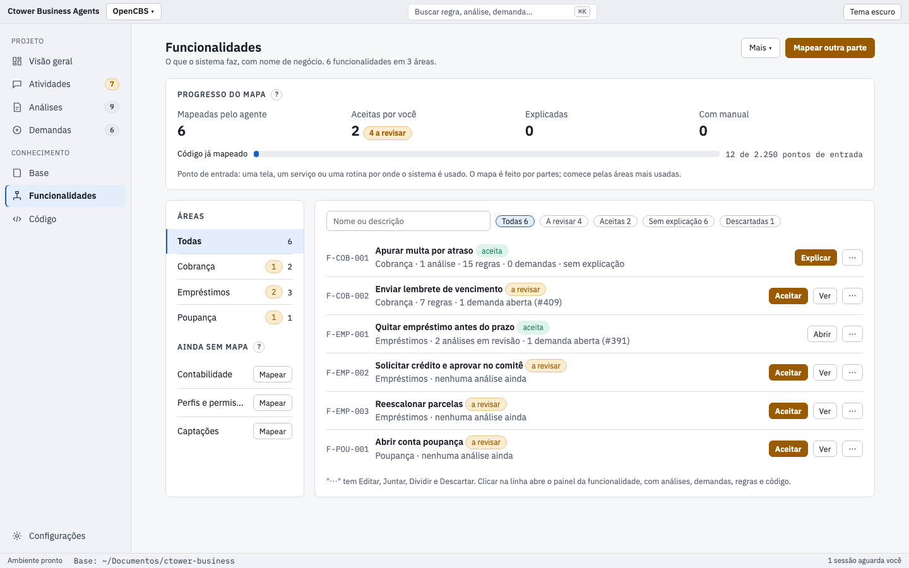

1. **Progresso do mapa no topo.** Quatro etapas com número (mapeadas pelo agente, aceitas por você, explicadas, com manual) e uma barra "código já mapeado". Responde "quanto falta" e dá sentido ao "a revisar". Fonte: `mapa_funcionalidades_projeto` (`MapaVista {total, pendentes, documentadas, completude}`); falta só a contagem das que têm manual.
2. **Lista compacta, uma ação principal por linha.** A ação segue a situação: "Aceitar" em a revisar, "Explicar" em aceita sem explicação, "Abrir" nas demais. Editar, Juntar, Dividir e Descartar vão para o menu "⋯". Seis funcionalidades cabem em meia tela.
3. **A linha mostra o que o painel sabe:** análises, regras e demandas ligadas. Clicar na linha abre o painel da funcionalidade, que continua como está.
4. **Lacunas junto do mapa.** O bloco "Ainda sem mapa" lista as partes do código muito usadas e sem funcionalidade nem regra, com nome de área quando houver e a ação "Mapear" já com o recorte preenchido. Fonte: `cobertura_projeto_app` (`lacuna`, `centralidade`, `sugestao`). A lista de pastas completa fica em "Código".
5. **Vínculo de demandas sai daqui.** A área Demandas (seção 8) passa a mostrar a funcionalidade de cada issue e a sugerir o vínculo; "Vincular demandas" deixa de ser uma tela à parte dentro do mapa. Enquanto a área Demandas não existir, a correção mínima é dar rótulo aos ícones e buscar os últimos seis meses ao abrir.
6. **Mapa vazio que ensina.** Em vez dos 2.250 pontos, uma frase sobre o que é o mapa, as três áreas mais usadas como sugestão de começo e o botão "Mapear". A lista de pontos fica atrás de "Ver os pontos de entrada".
7. **Linguagem.** "Ponto de entrada" ganha a explicação fixa "tela, serviço ou rotina por onde o sistema é usado"; "sem tratamento" vira "ainda sem funcionalidade"; "Religar documentos" e "Atualizar" vão para o menu "Mais".

### 9.3 Base de conhecimento: como está

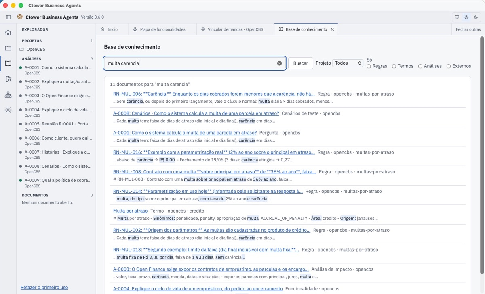

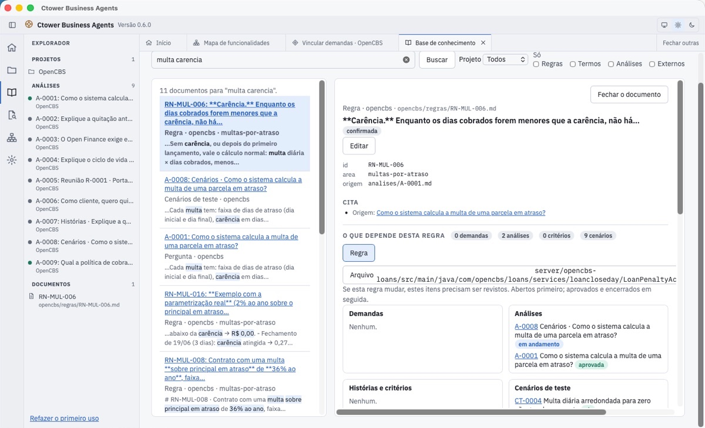

O que funciona:

- **A busca** acha sem acento ("carencia" encontra "carência"), destaca os termos no trecho e responde rápido.
- **"O que depende desta regra"** (print 20): demandas, análises, critérios e cenários que precisam ser revistos se a regra mudar. É a informação mais valiosa da tela.
- Edição do documento pela interface e a conferência das evidências com o código.

Problemas:

| ID | Problema | Onde | Heurística | Grav. |
|---|---|---|---|---|
| B-05 | No documento aberto, o texto da regra vem por último: antes dele aparecem o caminho do arquivo, os campos crus (`id`, `area`, `origem`), "Cita" e "O que depende desta regra" | print 20 | H8, H2 | 3 |
| B-07 | A base está em dois lugares: as regras e o glossário por área ficam na tela Projeto; a busca fica em Base. Quem quer "ver as regras de cobrança" não sabe onde ir | prints 02, 04 | H4, H6 | 3 |
| B-01 | Sem busca, a Base é uma lista plana de 43 documentos, sem agrupar por tipo nem por área, e a ordem não é explicada | print 04 | H6, H8 | 2 |
| B-02 | Os filtros "Só" cobrem regras, termos, análises e externos; não há como filtrar demandas, atas, histórias ou cenários, nem por situação (confirmada, a revalidar) ou área. O projeto vem em "Todos" | prints 04, 19 | H7 | 2 |
| B-03 | Títulos com markdown cru e cortados ("\*\*Carência.\*\* Enquanto os dias…"); o rótulo de tipo mistura documento e análise ("Pergunta", "Funcionalidade", "Parecer de revisão" são análises) | prints 04, 19, 20 | H4, H2 | 2 |
| B-04 | Abrir um documento espreme os resultados numa coluna estreita e cria uma barra de rolagem horizontal, por causa do caminho do arquivo de código | print 20 | H8 | 2 |
| B-06 | As áreas aparecem como identificador ("multas-por-atraso", "geral") e com o aviso "fora do projeto.md", que o analista não tem como interpretar | prints 02, 19 | H2 | 2 |
| B-08 | O resultado da busca não mostra a situação da regra; exemplos e respostas que viraram regra (RN-MUL-016, da #205) aparecem com o mesmo peso das regras | print 19 | H1 | 2 |
| B-09 | Um documento com problema (RN-MUL-999) abre a lista como "Documento", sem aviso; a tela Projeto diz "1 documento com problema" sem link | prints 04, 02 | H9 | 1 |

### 9.4 Base de conhecimento: proposta

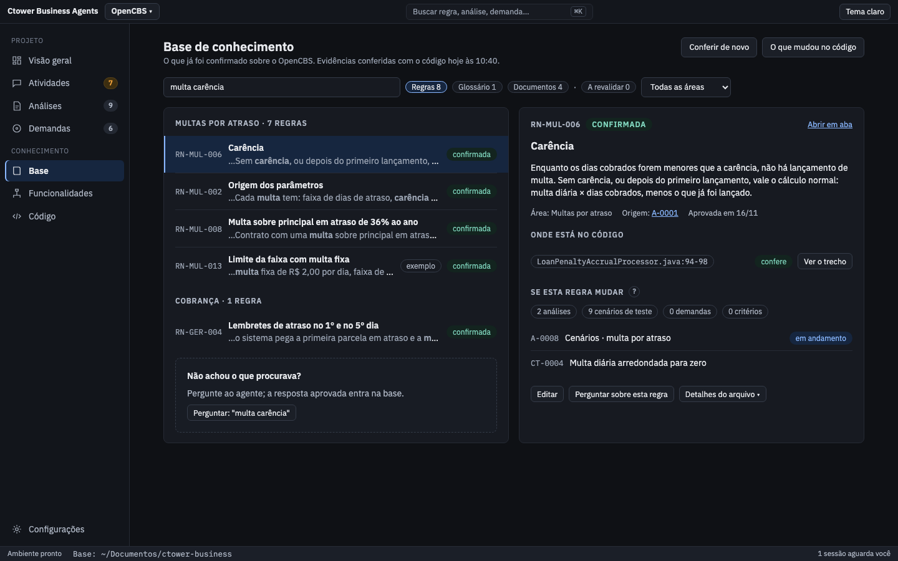

1. **Um lugar só.** As regras e o glossário saem da tela Projeto e vêm para Base, em três abas com contagem: Regras, Glossário e Documentos (análises aprovadas, atas, histórias, cenários, externos). A busca vale para as três e mostra quantos resultados há em cada uma.
2. **Agrupar por área, com nome legível**, e filtrar por área e por situação. "A revalidar" é um filtro sempre à vista, porque é o que pede ação.
3. **Título limpo.** A regra mostra o título curto (o trecho em negrito da afirmação, sem markdown) e o trecho encontrado embaixo. Exemplos ganham o selo "exemplo".
4. **Leitura com o texto primeiro.** No painel da regra: título e situação, o texto, e depois "Onde está no código" (nome do arquivo e linhas, com o caminho completo no hover), "Se esta regra mudar" (o atual "O que depende desta regra") e "Detalhes do arquivo" fechado. O painel divide a largura em partes iguais com a lista; "Abrir em aba" dá a página inteira.
5. **Busca sem resultado, ou com resultado fraco, leva à pergunta.** "Não achou o que procurava? Perguntar ao agente" abre a análise com o texto da busca.
6. **Conferência das evidências no cabeçalho** ("conferidas hoje às 10:40", "Conferir de novo", "O que mudou no código"), que hoje ficam na tela Projeto.
7. **Documento com problema** aparece num aviso com o erro em português e a ação "Abrir para corrigir".

Dados: a busca, a consulta reversa e a conferência já existem (`TelaBase`, `ConsultaReversa`, `revalidar`). Faltam o título curto da regra (hoje o título gravado é o texto da afirmação; ver E-05 da #205) e o nome legível da área nas regras de áreas não declaradas no `projeto.md`.

### 9.5 O que muda no menu

| Hoje | Proposta |
|---|---|
| Projeto › Áreas, Regras, Glossário | Base › Regras e Glossário, agrupados por área |
| Projeto › Cobertura | Funcionalidades › Ainda sem mapa; resumo na Visão geral |
| Projeto › Mapa (estrutural) e "O que mudou no código" | Código |
| Base › busca | Base › busca, sobre as três abas |
| Mapa de funcionalidades | Funcionalidades |
| Mapa › Vincular demandas | Demandas |

Com isso a tela "Projeto" atual deixa de existir: tudo o que ela mostra passa a ter um lugar com nome.

## 10. Plano de implementação

Issues candidatas para um épico. Esforço: P até 1 dia, M de 2 a 4 dias, G uma semana ou mais. Nenhuma foi criada.

| # | Título sugerido | Cobre | Prioridade | Esforço | Depende de |
|---|---|---|---|---|---|
| 1 | feat(resumo): comando `resumo_projeto_app` com contagens de análises, pendências de revisão, demandas e sessões | seção 6.2 | alta | M | |
| 2 | feat(ui): navegação por projeto, com seletor na barra de título e menu lateral com rótulos e contagens | P-01, P-06, P-08 | alta | G | |
| 3 | feat(ui): Visão geral do projeto (dashboard) | P-01, P-05, P-09, P-20 | alta | M | 1, 2 |
| 4 | feat(ui): Atividades, a caixa de entrada do analista, com a lista completa de próximos passos por projeto | P-05, P-19 | alta | M | 1, 2 |
| 5 | fix(demandas): validar o status da demanda com o rastreador | P-04 | alta | M | já é a #292 |
| 6 | feat(demandas): listagem das issues do rastreador com cache, busca e filtro de estado | P-03 | alta | M | 5 |
| 7 | feat(ui): área Demandas com "Analisar impacto" na linha, painel da issue e o vínculo com funcionalidades | P-03, P-18, F-06 | alta | M | 2, 6 |
| 8 | feat(ui): primeiros passos e estados vazios que ensinam; correções do assistente de primeiro uso | P-14, P-15, P-17 | média | M | 3 |
| 9 | feat(ui): linguagem e ajuda no contexto (termos do app, motivo dos botões desabilitados, "?") | P-11, P-13, P-15 | média | P | |
| 10 | refactor(ui): Análises como lista com filtros; "Nova análise" como ação global | P-02, P-07 | média | M | 2 |
| 11 | refactor(ui): Funcionalidades com progresso do mapa, lista compacta com uma ação principal e lacunas de cobertura | F-01 a F-05, F-07, F-08, P-09, P-17 | média | M | 2 |
| 12 | refactor(ui): Base em abas (regras, glossário, documentos) com filtros por área e situação, e leitura com o texto primeiro | B-01 a B-08, P-09, P-16 | média | G | 2 |
| 13 | fix(base): título limpo das regras (sem markdown) e nome legível das áreas | B-03, B-06, P-10 | média | P | |
| 14 | fix(ui): tela da análise: selos sem corte, largura do documento sem conversa e diálogo "Aprovar" resumido | P-11, P-12 | média | P | |
| 15 | feat(sessoes): listar as sessões do projeto com estado e histórico de atividade persistente | P-19, seção 6.2 | baixa | M | 1 |
| 16 | feat(demandas): listar issues do GitLab | seção 8.1 | baixa | M | 6 |

Ordem sugerida:

1. **Primeira entrega (1, 2, 3, 4):** dashboard e condução com os dados que já existem. A atividade recente usa as datas disponíveis, e o bloco de demandas mostra só as da base.
2. **Segunda entrega (5, 6, 7):** issues do rastreador.
3. **Terceira entrega (8 a 14):** primeiro uso, linguagem e reorganização de Análises, Funcionalidades e Base.
4. **Depois (15, 16).**

As issues 9, 13 e 14 são independentes e podem entrar a qualquer momento.

Itens da #205 que continuam valendo e não foram repetidos aqui: títulos de regra com markdown cru (E-05), contagens de pendências divergentes na mesma tela (E-16) e chips de evidência cortados (M-12).

## 11. Decisões em aberto

1. **Tela inicial com vários projetos.** A proposta abre a Visão geral do último projeto e deixa a comparação para o seletor. A alternativa é manter um Início com todos os projetos acima do nível do projeto. Recomendo a primeira: o uso típico da spec é um projeto por analista.
2. **Abas.** A proposta mantém abas só para objetos abertos. Tirar as abas de seção muda um hábito de quem já usa o app.
3. **Onde os protótipos ficam.** A issue pede `docs/ux/`; a regra do Control Tower manda artefatos de análise para o ct-docs. Segui a issue, por ser a entrega dela.

## 12. Critérios de aceite

- [x] Diagnóstico com prints de cada jornada e problemas classificados por gravidade (seções 3.3 e 4), com os limites da seção 2: a sessão ao vivo usa o print da #205 e o mapa de funcionalidades foi preenchido à mão.
- [x] Proposta de navegação comparada com a atual (seção 5).
- [x] Dashboard com cada indicador ligado à fonte de dados (seção 6.2).
- [x] Condução cobrindo o primeiro uso e o uso diário (seção 7).
- [x] Lista de issues do rastreador com o fluxo até "analisar impacto" (seção 8).
- [x] Protótipos das telas principais (`prototipos/`, seis telas, claro e escuro).
- [x] Lista de issues candidatas para o épico (seção 10).
- [x] Nenhum arquivo fora de `docs/` alterado.
