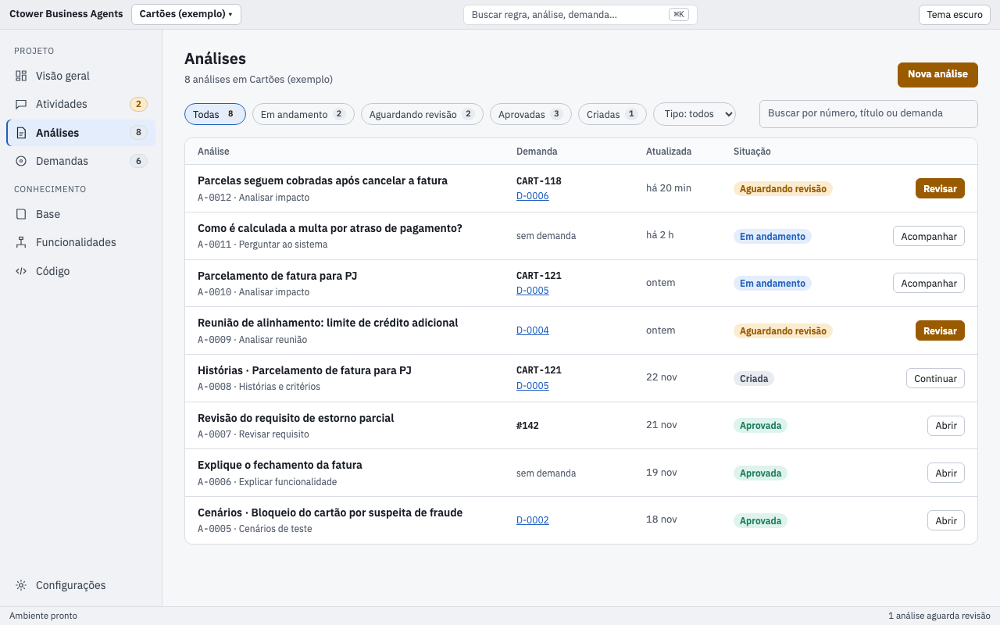
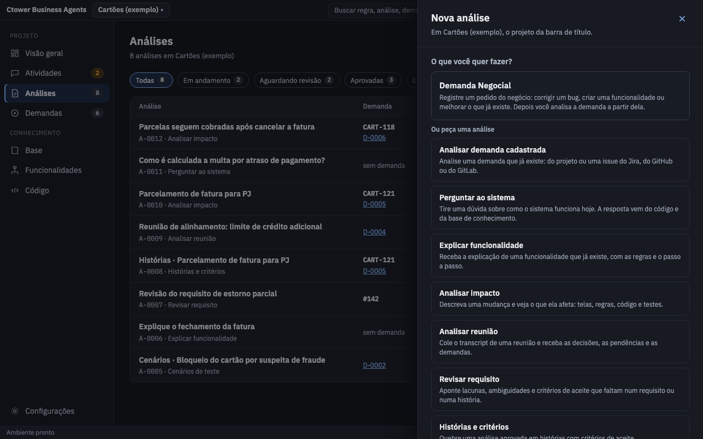
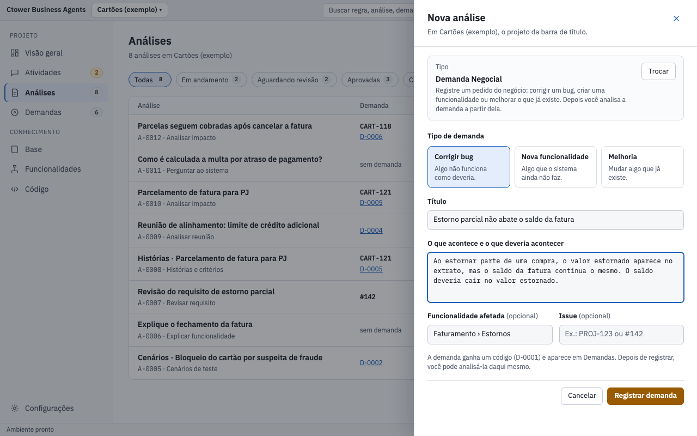
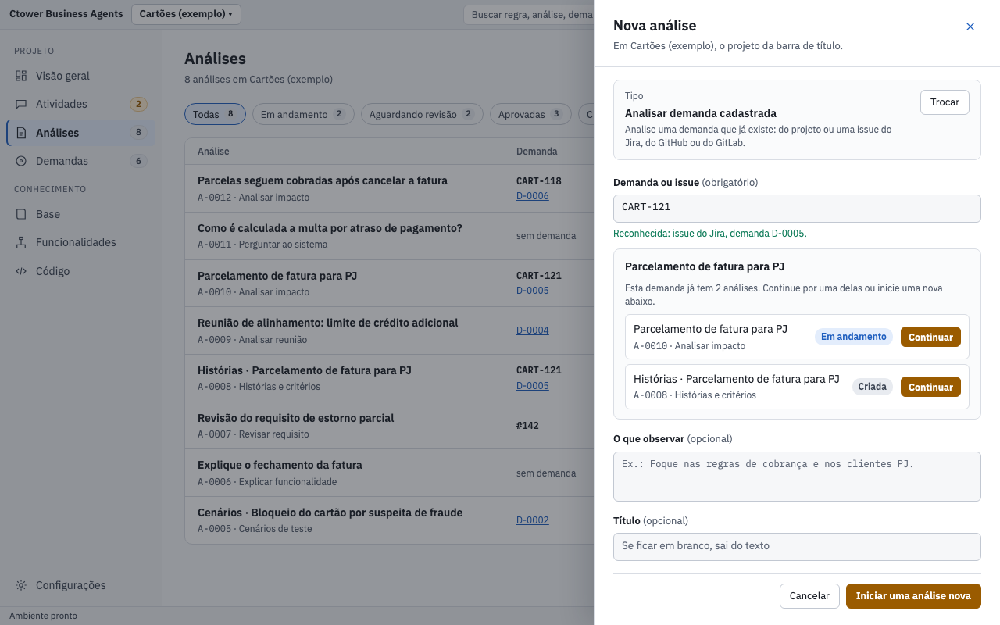

# Revisão de UX: tela Análises

- **Data:** 2026-11-25
- **Issues:** #350 (pedido da revisão) e #354 (este relatório, o protótipo e o plano)
- **Implementação:** PR #353, na `develop` em `e622f79`
- **Protótipos:** [`prototipos/index.html`](prototipos/index.html), telas 7 a 10 (HTML estático, claro e escuro), e o canvas navegável em https://claude.ai/artifact/CkXbARY4WDbibG8Y14ossc (privado; o dono precisa compartilhar para outros abrirem)
- **Relatório anterior:** [`2026-11-23-revisao-ux.md`](2026-11-23-revisao-ux.md) (#312), cuja issue 10 do plano ("Análises como lista com filtros") virou a #326

## 1. Resumo

Depois da #326, a tela Análises abria com o formulário de nova análise aberto, e a lista, que é o conteúdo da tela, ficava abaixo da dobra. O projeto era escolhido em três lugares e o formulário tinha sete tipos sem explicação.

O PR #353 fez da lista o conteúdo da tela e levou "Nova análise" para um painel lateral, com a escolha do tipo explicada. A barra de título passou a ser o único lugar de escolher o projeto. Na validação no app surgiram dois pontos de entrada novos: **Demanda Negocial**, para registrar o pedido do negócio, e **Analisar demanda cadastrada**, para analisar uma demanda ou issue que já existe.

Ficam quatro issues, no épico #357 (seção 7): o tipo da demanda num campo próprio, o mesmo padrão de "demanda e análises existentes" em mais três tipos, os títulos em caixa alta nos formulários abertos fora do painel e os filtros fixos quando a lista rola.

## 2. Como a revisão foi feita, e os limites

- A tela foi revista com a mesma régua da #312: as dez heurísticas de Nielsen (H1 a H10) e a persona do analista de requisitos, com a gravidade de 0 a 4.
- O diagnóstico (seção 3) vem dos problemas descritos na #350, observados no app em `tauri dev` a partir de `wip/autonoma`, depois da #326.
- A implementação e as decisões (seções 4 e 5) foram validadas no app durante o PR #353, como diz a descrição do PR.
- **O protótipo é um redesenho, não um print do app.** As telas 7 a 10 reproduzem o que o #353 implementou, com as medidas de `ui/src/telas.css` e `ui/src/theme.css`: a grade da tabela (`minmax(0, 1fr) 150px 96px 160px 120px`), o painel de 520 px, a barra de título de 38 px e a barra de status de 24 px. Os textos são os do código (`TelaAnalise.tsx`, `NovaAnalise.tsx`, `DemandaNegocial.tsx`). O app não tem modo de navegador com dados simulados, e o print do app real exigiria uma base descartável com análises fictícias.
- Os dados são fictícios: o projeto "Cartões (exemplo)", as issues CART-118, CART-121 e #142 e as demandas D-0002 a D-0006.

## 3. Diagnóstico: a tela antes do #353

| ID | Problema | Heurística | Grav. |
|---|---|---|---|
| AN-01 | O formulário de nova análise vem aberto, com "Revisar requisito" pré-selecionado, e ocupa quase toda a tela; a lista só aparece abaixo da dobra | H8 | 3 |
| AN-02 | O projeto é escolhido em três lugares: a barra de título, o "Projeto" ao lado do título da página e o "Projeto" do formulário. Não fica claro qual manda | H4, H5 | 3 |
| AN-03 | "Nova análise" aparece no menu lateral e no topo da tela; com o formulário já aberto, o botão do topo não faz nada visível, e "Cancelar" não tem o que cancelar | H4, H3 | 2 |
| AN-04 | Sete botões de tipo sem dizer o que cada um faz nem quando usar | H6, H10 | 3 |
| AN-05 | "Chave no rastreador" e "Demanda" tratam da mesma ligação com a issue; o campo da chave é estreito e o placeholder sai cortado | H4, H8 | 2 |
| AN-06 | "Iniciar a análise" aparece desabilitado sem dizer o que falta; o texto do requisito pede "ou informe a issue acima" | H1, H9 | 2 |
| AN-07 | Os filtros de situação não têm contagem nem mostram qual está ativo; o seletor "Todos os tipos" tem estilo diferente dos chips | H1, H4 | 2 |
| AN-08 | A linha da lista mostra o título como link sublinhado e o tipo em texto solto, sem data, sem a demanda ligada e sem ação principal | H6, H8 | 2 |
| AN-09 | A tela não mostra o total de análises (o menu diz "2", a tela não) | H1 | 1 |
| AN-10 | Títulos em caixa alta ("REVISAR REQUISITO", "ANÁLISES"), diferente do resto do app | H4 | 1 |
| AN-11 | Aba "mapa" em minúscula e com o nome antigo (a tela agora é Funcionalidades) | H4 | 1 |
| AN-12 | "Refazer o primeiro uso" fica sempre à vista no pé do menu, com o peso de um link comum | H8, H5 | 1 |

## 4. Proposta e o que o #353 implementou

### 4.1 A lista como conteúdo da tela

- **Cabeçalho com o total** ("8 análises em Cartões (exemplo)") e um só "Nova análise", que saiu do menu lateral. Resolve AN-03 e AN-09.
- **Um só seletor de projeto**, o da barra de título. O painel diz "Em Cartões (exemplo), o projeto da barra de título". Resolve AN-02.
- **Filtros de situação com contagem** (Todas, Em andamento, Aguardando revisão, Aprovadas, Criadas). O ativo fica marcado, e o filtro de tipo e a busca seguem o estilo dos chips. A contagem respeita o tipo e a busca, para bater com a lista. Resolve AN-07.
- **Tabela com colunas Análise, Demanda, Atualizada e Situação** e uma ação principal por linha, que segue a situação: "Revisar" em destaque quando a análise aguarda revisão, "Acompanhar" em andamento, "Continuar" criada e "Abrir" aprovada. Resolve AN-08.
- **Coluna Demanda**: a chave no rastreador e a demanda da base (D-NNNN), que abre a demanda. `listar_analises` passou a ler a demanda do frontmatter, e a busca acha por ela.

### 4.2 "Nova análise" em painel lateral

- **Dois passos**: primeiro o tipo, cada um com uma frase do que faz; depois o formulário do tipo, com "Trocar" para voltar. Esc e o ✕ fecham o painel, e a lista continua atrás. Resolve AN-01 e AN-04.
- **"Chave no rastreador" e "Demanda" viraram um campo só** ("Issue ou demanda"), com sugestões das demandas do projeto e das issues abertas. Aceita D-0012, PROJ-123, #142 ou o link da issue. Resolve AN-05.
- **O motivo de o botão estar desabilitado fica à vista** acima dele ("Para iniciar, informe a demanda ou a issue."). Resolve AN-06.

### 4.3 Outros itens

- **"Refazer o primeiro uso"** saiu do pé do menu e foi para o cabeçalho de Configurações. Resolve AN-12.
- **Correção na ligação com a issue**: a análise criada direto da issue gravava o link em `demanda.origem` e nunca casava com a issue. Agora casa pela chave, e a issue traz todas as análises ligadas.
- **WebKit (macOS)**: clicar numa sugestão do campo não selecionava, porque a lista fechava no blur.

## 5. Decisões tomadas na validação no app

### 5.1 Demanda Negocial como ponto de entrada

O pedido do negócio chega antes de qualquer análise. "Demanda Negocial" é o primeiro item do painel, em destaque, acima de "Ou peça uma análise".

- O analista escolhe o tipo (Corrigir bug, Nova funcionalidade, Melhoria). O rótulo e o exemplo da descrição mudam com o tipo ("O que acontece e o que deveria acontecer" num bug).
- A funcionalidade e a issue são opcionais. Com uma issue que já é demanda do projeto, o registro é bloqueado ("A issue já é a demanda D-0005: analise a que existe, em vez de registrar de novo") e o painel oferece analisar a demanda existente.
- Depois de registrar, o painel oferece "Analisar esta demanda", que abre a análise de demanda cadastrada já preenchida.
- Enquanto a demanda não tem campo de tipo na base, o tipo vai na primeira linha da descrição (`**Tipo:** Corrigir bug`). Ver a #358.

### 5.2 Demanda ou issue obrigatória na análise de demanda cadastrada

"Analisar demanda cadastrada" parte de algo que já existe. Por isso o campo "Demanda ou issue" é obrigatório, e a entrada de texto vira "O que observar", opcional. Com uma issue aberta do rastreador, a análise cria (ou reaproveita) a demanda dela, como "Analisar impacto" em Demandas, para as próximas análises acharem a mesma demanda.

### 5.3 Título e análises existentes em todos os tipos com demanda

Ao escolher ou digitar a demanda ou a issue, o formulário mostra o título dela e as análises que ela já tem, com a situação e "Continuar" (criada ou em andamento) ou "Abrir". O botão principal vira "Iniciar uma análise nova". Assim o analista não cria uma segunda análise de impacto da mesma demanda por engano. Vale para os tipos que têm o campo "Issue ou demanda": Explicar funcionalidade, Analisar impacto, Analisar reunião, Revisar requisito, a demanda cadastrada e a Demanda Negocial. Perguntar ao sistema, Histórias e critérios e Cenários de teste não têm esse campo (#359).

### 5.4 "Refazer o primeiro uso" em Configurações

O assistente de primeiro uso é raro depois da instalação. No pé do menu, com peso de link comum, ele competia com a navegação. Ficou no cabeçalho de Configurações, perto do que configura.

## 6. Conferências pedidas na #354

### 6.1 A lista aparece sem rolagem em 1280×800

Conferido no protótipo da tela 7, com o viewport em 1280×800 no Chrome headless e a medida feita pelo próprio protótipo (`7-analises.html?medir=1` escreve as medidas no título da página):

| Medida | Valor |
|---|---|
| Área de conteúdo (entre a barra de título e a de status) | 738 px |
| Topo da primeira linha da tabela | 249 px |
| Altura de uma linha (título e número em duas linhas) | 62 px |
| Fim da tabela com 8 análises | 743 px, 33 px acima do fim da área de conteúdo |
| Linhas que cabem sem rolar | 8 |

O cabeçalho, os filtros e as 8 análises aparecem inteiros sem rolagem. A página ainda rola 7 px por causa da margem de baixo, depois da tabela. Com mais de 8 análises, a página rola inteira, e o total, os filtros e o cabeçalho da tabela saem de vista (#361).

Ressalva: a medida é do protótipo, que copia as medidas do CSS do app. Não foi repetida no app, que abre com 1280×820 (`ui/src-tauri/tauri.conf.json`), 20 px a mais que a janela conferida.

### 6.2 Itens da #350 sem confirmação

| Item | Situação | Como foi conferido |
|---|---|---|
| Aba "mapa" em minúscula e com o nome antigo | **Resolvido.** As seções não abrem mais aba: `chaveDoObjeto` (`ui/src/Navegacao.tsx`) devolve `null` para a tela "mapa", e Funcionalidades troca no lugar. As abas ficam só para objetos abertos (análise, documento, demanda, "Vincular demandas · projeto"). | leitura do código na `develop` em `e622f79` |
| Título em caixa alta | **Resolvido na tela Análises; falta fora dela.** "Análises" é `h2` em caixa normal, o painel tem `text-transform: none` no título, e os formulários no painel não mostram título (`semTitulo`). Mas os mesmos formulários abertos pelo painel da demanda (`PainelDemanda.tsx`), pelo painel da funcionalidade (`PainelFuncionalidade.tsx`) e por `TelaInicio.tsx` ainda mostram o tipo num `h3`, que a regra `.page h3` de `telas.css` põe em caixa alta ("ANALISAR IMPACTO"). | leitura do código; #360 |

## 7. Plano: épico #357

No épico #357, separado do #317: são continuações da tela Análises e da Demanda Negocial, não da revisão da #312, que o #317 implementa. A #354 pedia ligar as candidatas ao #317; a mudança foi pedida na revisão deste relatório. Esforço: P até 1 dia, M de 2 a 4 dias. O épico e as issues foram criados como #357 e #358 a #361.

| # | Título sugerido | O que faz | Prioridade | Esforço |
|---|---|---|---|---|
| #358 | feat(demandas): tipo da demanda (bug, funcionalidade, melhoria) em campo próprio | Grava o tipo no frontmatter da demanda, em vez da linha `**Tipo:**` que `descricaoDaDemanda` põe no texto. Mostra o tipo no painel da demanda e filtra por ele em Demandas. As demandas já gravadas com a linha no texto são lidas como antes, ou migradas. | média | M |
| #359 | feat(ui): Perguntar ao sistema, Histórias e critérios e Cenários de teste mostram a demanda e as análises existentes | Mesmo padrão da seção 5.3. Na pergunta, entra o campo opcional "Issue ou demanda". Em Histórias e Cenários, a análise de origem mostra a demanda dela e as histórias ou os cenários que essa demanda já tem, com "Continuar" e "Abrir". | média | M |
| #360 | fix(ui): título dos formulários de análise em caixa normal fora do painel Nova análise | Os formulários abertos por `PainelDemanda`, `PainelFuncionalidade` e `TelaInicio` passam a mostrar o tipo como no painel (bloco "Tipo" ou título em caixa normal), sem a caixa alta de `.page h3`. | baixa | P |
| #361 | feat(ui): Análises com o cabeçalho e os filtros fixos ao rolar a lista | Com mais de 8 análises em 1280×800 a tabela rola. O total, os filtros e o cabeçalho da tabela ficam no topo da área. | baixa | P |

As quatro são independentes. A #359 reaproveita `DemandaAchada` e `useDemandaResolvida` de `NovaAnalise.tsx`.

## 8. Critérios de aceite da #354

- [x] Relatório curto com o diagnóstico, a proposta e o que foi implementado (seções 3 a 5).
- [x] Protótipo estático em claro e escuro em `docs/ux/prototipos/` (telas 7 a 10, com prints nos dois temas).
- [x] Registro de que a lista aparece sem rolagem em 1280×800 (seção 6.1, medida no protótipo).
- [x] Plano de implementação do restante em issues (seção 7): épico #357, com #358 a #361.
- [x] Nenhum dado de projeto real no relatório nem nos prints: projeto, issues e demandas são fictícios.
